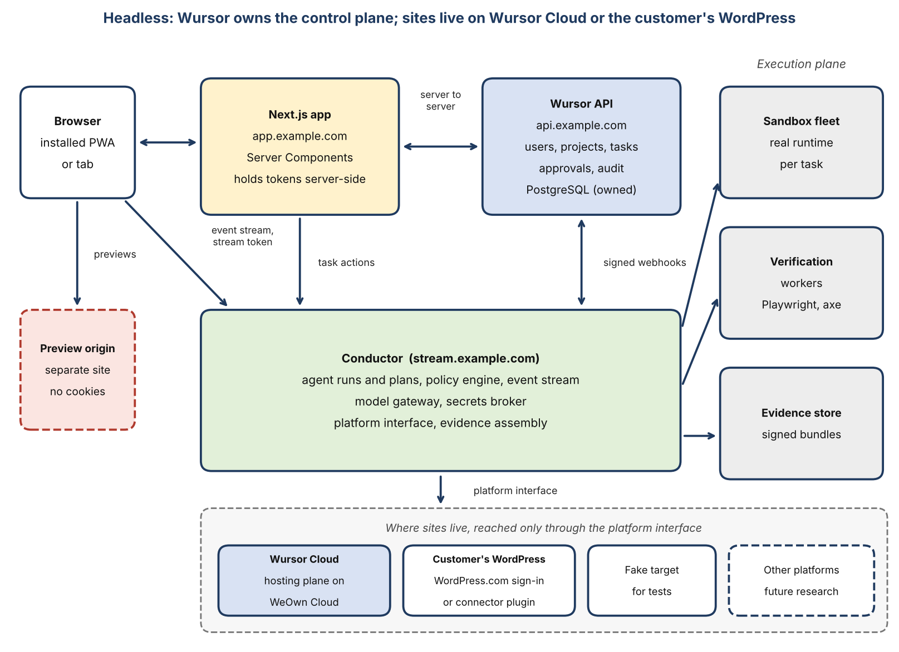

# Product Requirements Document

> **Wursor PRD: Headless, revision 4** (October 10, 2026). This replaces PRD v2.0 (August 13, 2026, the Hybrid plugin-and-sandbox model); the previous text is in git history at `e9de6ba`. Requirement IDs: AG, SB, VR, RV, RL, MM, FL, CN, ID, AU, UX (shared), HL, SH, PX (this pattern). The Word original is kept by the product lead.

**Wursor PRD: Headless**

Wursor delivered as a Next.js application with its own control plane, working on WordPress sites first

| **Item** | **Detail** |
|---|---|
| Document | Standalone product requirements for the Headless delivery pattern (revision 4) |
| Date | October 10, 2026 |
| Status | Draft. Numeric targets are hypotheses. |
| Revision note | Revision 4 brings the document in line with the finished screen-level design: sign-in and its verify steps, the Publish action, the Board with a calendar view, the command palette, system states, mobile and dark parity, and the marketing site. It adds the PX requirement family and section 26. Revision 3 adds where a site lives. A person can start a brand-new site on Wursor Cloud (hosted on WeOwn Cloud), connect a WordPress site they already have, or build in Wursor and publish to their own WordPress, and can move a site in either direction. Revision 2 made the control plane Wursor-owned and WordPress the first target platform. |
| Companion documents | Wursor PRD: Unified (decision framework and roadmap, not yet updated for revision 2) and Wursor PRD: Hybrid App Shell |
| Requirement IDs | Shared: AG, SB, VR, RV, RL, MM, FL, CN, ID, AU, UX. Pattern: HL-01 to HL-19, SH-01 to SH-16, PX-01 to PX-14 |

## Executive summary

This document specifies Wursor as a Headless product. Wursor is a web-based agentic development environment: a person describes work in plain language, an agent carries it out in an isolated copy of their site, and the person reviews evidence before anything reaches the live site. The first platform it works on is WordPress. The aim is a product that a non-technical site owner can use without knowing how any of it works, and that can later extend to other kinds of sites without being rebuilt.

That aim drives one decision that differs from the earlier version of this document. In revision 1, WordPress stayed the system of record for users, projects and approvals, with a thin adapter that could be replaced someday. That would have left Wursor dependent on WordPress for its own accounts and data, which is the opposite of what is wanted. In this revision **Wursor owns its control plane**: its own database, its own sign-in, and its own API. WordPress sites are **target platforms**. Wursor connects to them through a small connector plugin, works on test copies of them, and applies approved changes to them, but it keeps no product data inside them.

The product is a Next.js application. A server-side layer inside it keeps sign-in tokens away from the browser. The Wursor API, backed by PostgreSQL, holds users, organizations, projects, tasks, approvals, policies and the audit log. A separate Conductor service runs the agents, enforces policy, streams progress to the browser and assembles evidence. Everything that touches a customer site goes through a **platform interface**, and WordPress is its first implementation.

Revision 3 adds a second decision: **where a site is built is separate from where it lives.** Every site is built, previewed, approved and recorded in Wursor, on a safe copy. After that, it lives in one of two places. It can be hosted on **Wursor Cloud**, which runs on WeOwn Cloud and handles the domain, certificate, updates and backups. Or it can live on a **WordPress the customer already has**, connected by WordPress.com sign-in or by the Wursor connector plugin. First-time owners start on Wursor Cloud. Owners with a site connect it. Owners with an empty WordPress build in Wursor and publish there. A site can move in either direction at any time, with a verified copy, an approval and a rollback point, and with the exit stated in plain words from the first screen.

Revision 4 adds no new architecture. It records what has been designed. The product now exists as a screen-level prototype of about 650 frames in four matching sets (light and dark, desktop and mobile), built from one shared component library, with a marketing site of six pages in the same four sets. Every screen is reachable from the landing page. Section 26 maps the screens to requirements, the PX family turns what the design shows into testable statements, and the design gaps that remain are listed in 26.4. Nothing in the prototype has been tested with real owners yet, so every usability target in this document is still a hypothesis.

| |
|---|
| **What this costs.** Building identity, sessions and the control-plane API takes longer than reusing WordPress for them, and hosting sites turns part of Wursor into an operations business: updates, security, backups, abuse handling and an availability promise. The rollout plan in section 22 reaches hardening in about 46 weeks, against about 32 for the Hybrid plan. The platform interface is also designed from a single example, so expect to revise it when a second platform arrives. |

| |
|---|
| **Decision for leadership.** Operating a hosting service is a commitment that outlives the product launch. Section 5.3 and decision D-HL-7 set out the alternative of provisioning through a partner for the first release. The recommendation is to launch Cloud on WeOwn Cloud infrastructure only if WeOwn can staff on-call, security patching and abuse handling from the first customer, and otherwise to start with partner provisioning behind the same interface (SH-16). |

| |
|---|
| **Who should read what.** Product and design: sections 1 to 5, 16 and 26. Engineering: sections 10 to 15 and 19 to 22. Hosting and operations: sections 5.3, 11.5 to 11.9, 21 and 23. Security: sections 5, 12 and 18. Leadership: this summary, section 23 (risks and exit ramps) and Appendix B (future research). |

## 1. Product definition

Wursor is a web-based agentic development environment. It belongs to the same family of products as Claude Code, Codex and Cursor: a person describes the work they want done, an agent plans and carries it out inside an isolated runtime, and the person reviews the result before anything reaches production. What makes it different from those tools is that it is built around a particular kind of site. It begins with WordPress, understands block themes, content-only editing, plugin and theme updates and the particular ways a WordPress site can break, and builds its verification and review steps around those facts instead of treating a site as just another code repository.

It is also built so that the person using it does not need to be technical. The people who commission and approve work are often site owners, not developers. The interface therefore speaks in outcomes and evidence, and keeps code, hashes and logs one step deeper for those who want them.

### 1.1 The three jobs the product must do

- **Lane A, editable sites.** Create attractive, functional websites that non-technical people can safely edit afterwards, starting from a short brief and a choice of design directions. The agent produces a block theme, patterns and content, and the product verifies that an editor can actually change the content without breaking the design. The finished site can live on Wursor Cloud or on the owner's own WordPress.

- **Lane B, web apps and PWAs.** Create and update web applications, from heavy-functionality tools to installable progressive web apps.

- **Lane C, existing sites.** Manage sites that already run in production. This lane is about adoption and risk: the agent first learns the site, then proposes changes as replayable scripts that are tested on a copy before anyone applies them to the live site.

### 1.2 Positioning in one paragraph

General coding agents can already write a WordPress plugin or theme if you give them a repository. They are weak at everything around the code: provisioning a realistic runtime, proving that the editor experience still works, deciding whether a change to a live site is safe, remembering how a particular site was built, and showing a non-developer enough evidence to approve with confidence. Wursor sells that surrounding system. If a general agent with a good starter kit can match its results, the product has no reason to exist, which is why the plan includes an explicit baseline comparison and kill criteria in the roadmap.

### 1.3 Why web-based rather than a terminal or desktop tool

- **Shared state.** A task, its preview and its evidence need to be seen by more than one person. A web product gives every participant the same link.

- **Long-running work.** Agent runs can last tens of minutes. They have to continue on the server after the browser closes and be resumable from a phone.

- **Runtime access.** The product needs to start real WordPress runtimes in the cloud. A browser is the natural place to attach to them and to show their previews.

- **Approvals.** Review and approval are the point where responsibility transfers, and they need an authenticated, auditable surface that a terminal cannot easily provide.

### 1.4 Non-goals

- Wursor is not a general-purpose coding agent and will not try to support arbitrary stacks on equal terms. Lane B apps may use other frameworks, but the product optimizes for WordPress-adjacent work.

- Wursor Cloud is not a general-purpose host. It runs WordPress sites that are built and managed through Wursor. It does not host email, other applications or sites that Wursor does not manage, and it does not sell domains in the MVP.

- It is not a visual page builder. Humans keep using the WordPress editor for content; the agent produces structure that makes that editing safe.

- It does not promise autonomous production changes. Every change that touches a live site, wherever it lives, passes through an approval bound to evidence.

- It does not train or fine-tune models. It routes to model providers through a gateway.

- Wursor does not support platforms other than WordPress in the MVP or V1. The architecture leaves room for them (section 11), and what is known and unknown about them is listed in Appendix B.

- Wursor does not require customers to use WordPress for anything except the sites they want it to work on, and does not require them to host with Wursor. Their Wursor account, projects and approvals live in Wursor either way.

### 1.5 Where a site lives: the three starting paths

A site has two separate facts about it: where it is built and where it lives. It is always built in Wursor, on a safe copy, with a preview, an approval and a record. It lives either on Wursor Cloud or on a WordPress the customer connects. Keeping these apart is what lets one product serve a first-time owner with no site and an agency with forty.

| **Starting path** | **For whom** | **Where the site lives** | **First run** |
|---|---|---|---|
| Start on Wursor Cloud | A first-time owner with no WordPress yet. This is the default for people who say they have no site. | Wursor Cloud, on WeOwn Cloud. Domain, certificate, updates and backups are handled. | Brief, three design directions, first build on a safe copy, approve, go live at a temporary address, connect a domain. |
| Connect my WordPress | An owner with a live site, hosted anywhere. | Their own WordPress, unchanged. | Connect, read-only look at the site, then the first small change on a safe copy. |
| Build here, publish to my WordPress | An owner with an empty WordPress, or a new WordPress.com site, who wants to keep hosting there. | Their own WordPress. | The same as the Cloud path up to approval, then publish to their site as a release with a rollback point. |

The second and third paths are the same connection. They differ only in the first run: one starts from a site that exists, the other from a brief. A person can also move later. **Move to my own WordPress** takes a Cloud site out to a WordPress the person owns. **Host on Wursor Cloud** brings a connected site in. Both moves are in the first release, because a one-way door would make Cloud a lock-in, and an easy exit is part of why customers can trust the entry.

**What "my WordPress" means**

- **A WordPress.com site.** The person signs in with WordPress.com (OAuth) and chooses a site. This is the shortest path and works for people who have no technical knowledge of hosting.

- **A self-hosted WordPress on any host.** The person installs the Wursor connector plugin and enters a one-time code. This works on shared hosts, managed WordPress hosts and cloud servers alike.

- **A site where the plugin cannot be installed.** Some hosts and plans disallow plugins. In V1, an application password gives Wursor limited, revocable access to content.

**Full access and Content only**

What Wursor can do on a connected site depends on the access it is given. With **Full access** it can change themes, plugins, settings and content. With **Content only** it can change pages, posts, media and menus, and nothing deeper. Content moves almost everywhere. Theme and plugin changes need deeper access, and some hosts and plans do not allow it. Wursor shows the level on every site and explains it in plain words, so nobody is surprised by what the agent cannot do. A Cloud site always has Full access, because Wursor runs it. A custom-code Cloud site may not move cleanly to a Content-only destination, and Wursor says so before the move starts (SH-11).

## 2. Problem, insight and timing

### 2.1 The problem

People who build and maintain websites and apps face three recurring problems that agents make faster to attempt but not safer to finish. First, agent output is hard to trust: a change can look right in a screenshot and still break checkout, the editor, accessibility or a plugin interaction. Second, site work is stateful and site-specific, so a generic agent keeps rediscovering the same facts about a site and sometimes makes confident changes that conflict with them. Third, the people who must approve the work are often not the people who can read the diff, so approval turns into a leap of faith.

### 2.2 Contrarian insights that shape the product

1.  **The scarce resource is trust, not generation.** Models already generate competent themes and plugins. What teams lack is a cheap way to know a change is safe. The product spends more of its engineering effort on verification, evidence and rollback than on prompting.

2.  **Both ways in matter, and they are different markets.** Existing sites are the larger and harder market: the risk of a mistake is real and the agent's main job is restraint, so Lane C is a first-class lane. New sites are the way in for first-time owners, and generating a site is crowded and demos well, so Wursor does not compete on the first draft. It competes on what happens next: the same safe loop of copy, preview, approval and rollback for every later change, wherever the site lives.

3.  **Approval should be bound to evidence.** An approval that is not tied to a specific diff and a specific verification result can be invalidated silently by a later change. In Wursor an approval names the hashes of both, and changing either voids it.

4.  **The control plane should be owned, small and boring.** If a product's accounts, approvals and audit trail live inside the platform it manages, the platform's choices become the product's problems. Wursor keeps its own control plane and treats every platform as a place to work, not a place to live.

5.  **A general agent plus a good starter kit is the real competitor.** The product has to beat that baseline on measured outcomes, or it should not be built.

6.  **Where a site is built and where it lives are separate questions.** Most tools fuse them: you build in the tool and you are hosted by the tool, or you are in your own host and the tool is a plugin. Separating them lets a first-time owner start with no setup, lets an owner with a site keep it where it is, and makes leaving cheap. An easy exit is a reason to trust the entry, and it fits WeOwn's position that customers should own their stack.

### 2.3 Why now

Several pieces of platform groundwork arrived in the last year for the first target platform. WordPress 6.9 introduced the Abilities API, which gives plugins a standard way to declare what an agent may do, and the MCP Adapter (version 0.7.0 when this research was done) exposes those abilities to agent clients. WordPress 7.0, released on May 20, 2026, added a Connectors API and a DataViews-based admin. It also exposed a weakness: connector keys stored in the database are unencrypted and readable by any plugin, which is one reason this design keeps keys out of customer sites entirely. In parallel, isolated micro-VM sandbox providers have made it practical to give each task its own real runtime. WordPress Playground and my.WordPress.net are interesting but still experimental, so the plan treats them as optional accelerators and not as foundations.

### 2.4 Alternatives the customer already has

| **Alternative** | **What it does well** | **Where Wursor aims to beat it** |
|---|---|---|
| General coding agents (Claude Code, Codex, Cursor) | Strong code generation and editing across stacks; mature tooling; many users already have one. | Real WordPress runtime per task, editor-level verification, site memory, evidence-bound approvals, and a review surface non-developers can use. |
| WordPress.com MCP and hosted AI features | Direct, authenticated access to sites hosted there; content and site editing tools. | Works across hosts and with code changes, not only content; produces evidence before changes are applied. |
| Telex and similar block generators | Fast generation of blocks and small plugins from a prompt. | Covers whole sites, apps and maintenance with verification and rollback. |
| Fleet tools (Glow, InstaWP and others) | Updates, backups, monitoring and site creation across many sites. | Treated as connectors: Wursor calls them and adds planning, testing and approvals on top. |
| Agent workspaces such as Buzz | A place to assign work to agents and review it as a team. | Treated as an outside client of Wursor's API. Wursor supplies the runtime, evidence and policy that such a workspace lacks. |

| |
|---|
| **Caveat.** Capabilities of Glow, InstaWP and WordPress.com connectors, and the way Buzz attaches agents, are taken from public descriptions and have not been tested end to end. They are listed as assumptions in the unified PRD. |

## 3. Users and jobs to be done

| **Persona** | **Who they are** | **Job to be done** |
|---|---|---|
| Owner | Founder, marketer or operations lead who commissions the site or app and is accountable for it. Usually not a developer. | When I need a site or a change, I want to describe it in my own words and see a trustworthy preview, so I can approve it without learning the technical details. |
| Builder | Freelancer, agency developer or in-house engineer who guides the agent and fixes what it gets wrong. | When a task is too large to do by hand, I want to direct an agent that works in a real WordPress runtime, so I can ship more projects without losing control of quality. |
| Reviewer | Senior developer, QA lead or client contact who approves changes to production. | When a change is ready, I want a small set of evidence that tells me whether it is safe, so I can approve or reject quickly and defensibly. |
| Site steward | Person responsible for a portfolio of existing sites, often at an agency. | When many sites need updates and fixes, I want changes tested on copies and applied in a controlled order, so incidents do not multiply. |
| Platform admin | Administrator of Wursor deployment for an organization. | When I run this for a team, I want clear policies, budgets, audit logs and connector controls, so I can say yes to it with confidence. |

### 3.1 Core journeys

**Journey 1: a new editable site (Lane A)**

The owner opens a new project, describes the business and the pages they need, and uploads a logo. The agent proposes a plan with a sitemap, a style direction and the list of editable regions. After the owner approves the plan, the agent builds a block theme and content in a sandbox. Verification runs a visual check at several widths, accessibility and performance audits, and an editor test in which a scripted editor changes text and images in each editable region and confirms the layout holds. The owner sees the preview and the evidence summary, requests two changes, and approves the second version. The release step deploys to the chosen host with a rollback point.

**Journey 2: a heavy web app or PWA (Lane B)**

The builder describes an event-ticketing app: organizer accounts, event pages, checkout, QR check-in and an installable offline mode for door staff. The agent drafts a plan that splits the work into features, each with its own acceptance tests. It builds in the sandbox, runs end-to-end tests with Playwright, checks the PWA manifest, service worker behavior and offline flows, and records the evidence. The builder reviews each feature, and the reviewer approves the release candidate.

**Journey 3: safely updating an existing site (Lane C)**

The site steward connects an existing site through a fleet connector or a direct plugin. The agent first builds a dossier of the site (SITE.md): theme, plugins, custom code, traffic-critical pages and known fragilities. The steward asks for a plugin update and a fix to a form. The agent classifies the change by risk class, clones the site into a sandbox, applies the change as a replayable script, and runs regression checks against the critical pages. The reviewer receives the diff, the evidence and the exact script that will run in production, approves it, and the connector applies it with a backup taken first. If monitoring shows a regression afterwards, the rollback script runs.

**Journey 4: a first site, started on Wursor Cloud**

A first-time owner signs up, says they have no website and picks Start on Wursor Cloud. Wursor asks five short questions: what the business does, who it is for, the one thing visitors should do, the pages wanted and the tone. It returns three design directions as previews of the real homepage. The owner picks one, the agent builds the site on a safe copy, and the owner sees the preview and a plain summary of what was checked. After approving, the site goes live at a temporary address within minutes. The owner then connects a domain by following plain steps with live status, and the site moves to the domain with a certificate in place. From then on every change follows the same loop.

**Journey 5: connecting a site the owner already has**

An owner with a WordPress site on a shared host picks Connect my WordPress. If the site is on WordPress.com they sign in; otherwise they install the connector plugin and type the code it shows. Wursor reads the site, reports its access level (Full access or Content only), flags anything worrying such as no recent backup, and starts in read-only mode. The owner asks for a small first change, reviews a preview made on a copy, approves, and the change is applied with a backup taken first.

**Journey 6: moving a site, in either direction**

Eighteen months later the owner wants to host the site elsewhere. They open the site page, choose Move to my own WordPress, pick or connect a destination, and see a report of what will travel and what will not. Wursor builds a verified copy, shows a page-by-page comparison, and asks for an approval. After approval the owner switches the domain with a guided, reversible cutover. The Cloud site stays live and read-only for 30 days. In the other direction, an agency owner with a connected site chooses Host on Wursor Cloud, and the same steps run the other way, with the original left untouched.

### 3.2 First-time site owner

Revision 3 adds a persona the earlier drafts underserved. The first-time site owner has a business, no website and no technical vocabulary. They do not know what hosting, DNS or a theme is and should not have to.

| **Need** | **What the product does about it** |
|---|---|
| "I do not know what to ask for." | A five-question brief and three design directions shown as real previews, so choosing replaces describing. |
| "I do not know where it will live." | Start on Wursor Cloud is the default: no host to pick, no settings to see. |
| "What if I want to leave?" | The exit is stated on the first screen. A complete archive and a guided move to their own WordPress are always available (SH-08, SH-13). |
| "I cannot tell if it is safe." | The same evidence and plain-language review as every other site, from the first build. |
| "Where do I put my domain?" | A step-by-step connect flow with live checks, written for people who have never touched DNS (SH-12). |

## 4. Core concepts

Both delivery patterns expose the same objects and the same workflow. This section defines them once so the pattern-specific sections can refer to them.

### 4.1 Objects

| **Object** | **Definition** |
|---|---|
| Organization | The tenant. Owns members, policies, budgets and connectors. |
| Project | A site or app the organization is working on, with a lane, a repository, an environment list and a memory file set. |
| Task | A unit of requested work in a project. A task has a description, a lane, a plan and a state. |
| Run | One execution attempt of a task by the Conductor. A task can have several runs (retries, revisions). |
| Sandbox | An isolated runtime, created per run, containing a real WordPress install, the repository and the agent's tools. |
| Evidence bundle | A signed collection of verification results, screenshots, traces and the diff for a run. |
| Approval | A decision by a human reviewer, bound to the hashes of the diff and the evidence bundle. |
| Release | The act of applying an approved change to an environment, with a rollback point. |
| Connector | A configured link to an external system such as GitHub, a host, a fleet tool or a model provider. |
| Policy | A rule set that decides which actions the agent may take automatically, which require approval and which are forbidden. |

### 4.2 Task state machine

| **State** | **Meaning** | **Allowed next states** |
|---|---|---|
| Draft | The description exists but no plan has been made. | Planned, Cancelled |
| Planned | The agent has proposed a plan that awaits the builder's or owner's approval of scope. | Running, Draft, Cancelled |
| Running | The agent is working in a sandbox. | Verifying, Failed, Paused, Cancelled |
| Paused | The run waits for a human answer or an approval of a risky action. | Running, Cancelled |
| Verifying | Verification workers are executing the checks. | In review, Running (fix loop), Failed |
| In review | The evidence bundle is complete and awaits a reviewer. | Approved, Running (changes requested), Cancelled |
| Approved | A reviewer has approved a specific diff and evidence bundle. | Released, In review (if hashes change) |
| Released | The change has been applied to the target environment. | Monitoring, Rolled back |
| Monitoring | Post-release checks are watching for regressions. | Closed, Rolled back |
| Failed / Cancelled / Rolled back / Closed | Terminal states, each recorded with a reason. | None (a new task or run may reference them) |

### 4.3 What an evidence bundle contains

| **Item** | **Purpose** |
|---|---|
| Diff and file manifest | The exact change under review, with a hash. |
| Visual captures | Screenshots at defined widths for the pages affected, compared against the baseline. |
| Editor test result | Scripted editor session proving that editable regions still behave (Lane A), and block validation results. |
| Accessibility and performance reports | Automated audit output with pass and fail thresholds set by policy. |
| Test suite results | Unit, integration and end-to-end results, including PHPUnit and Playwright traces. |
| Regression comparison | For Lane C, a comparison of critical page behavior before and after, plus the replayable change script. |
| Security checks | Static analysis, dependency checks and a list of capabilities and endpoints added or changed. |
| Cost and run log | Model spend, tool calls and timings, so reviewers can see how the result was produced. |
| Signature | A signature from the verification service over the bundle hash, so the result cannot be altered unnoticed. |

### 4.4 Target platforms

A target platform is a kind of site that Wursor can connect to and work on. The WordPress target is the only one in scope for this document. Each target supplies the same set of operations through the platform interface (section 11), plus a runtime in which tasks can be tested. A WordPress site is a **site** belonging to a project; the project, tasks and approvals are Wursor objects. A site has a home: either Wursor Cloud, where Wursor provisions and runs it, or a WordPress the customer connects. Both homes are the same platform, WordPress, and differ in who runs the host.

### 4.5 Objects added for hosting and moves

| **Object** | **Definition** |
|---|---|
| Site home | Where a site lives: Wursor Cloud or a connected WordPress. Shown on every site. Changed only by a move. |
| Access level | What Wursor may do on a site: Full access (theme, plugins, settings, content) or Content only (pages, posts, media, menus). Cloud sites always have Full access. |
| Connection | The link between Wursor and a connected WordPress: WordPress.com sign-in, the connector plugin, or (V1) an application password. Revocable from either side. |
| Brief | The short description of a new site: what the business does, who it is for, the one thing visitors should do, the pages wanted and the tone. |
| Design direction | One of three proposed looks for a new site, shown as a preview of the real homepage. Choosing one starts the first build. |
| Cloud site | A WordPress site that Wursor runs on WeOwn Cloud, with a temporary address, backups, updates and monitoring. |
| Domain | A web address the owner connects to a site, with its status (waiting for DNS, checking, live) and certificate. |
| Move | A transfer of a site from one home to another. It is a release: it has a plan, evidence, an approval, a rollback point and an audit entry. |
| Hosting plan | The part of a subscription that covers running a Cloud site, billed separately from the work allowance. |

## 5. Architecture

The Headless pattern has a web app in front, a Wursor-owned control plane behind it, a Conductor that does the long-running agent work, an execution plane for sandboxes and verification, and a platform layer that reaches customer sites. The figure shows how they connect.

*Figure 1. Wursor owns the control plane. Sites, whether on Wursor Cloud or the customer's own WordPress, are reached only through the platform interface.*

### 5.1 The planes

- **Web app (Next.js).** The interface, plus a server-side layer that holds tokens and calls the other services on behalf of the signed-in person.

- **Control plane (Wursor API and PostgreSQL).** Holds users, organizations, memberships, projects, sites, tasks, approvals, policies and audit summaries. It is the system of record for who is allowed to do what.

- **Conductor.** Orchestrates agent runs. It contains the policy engine, the event stream, the model gateway, the secrets broker, the platform interface and the evidence assembler. It is the only component that talks to model providers and to customer sites. At MVP the control plane API and the Conductor may be deployed together as separate modules of one service, and split later (decision D-HL-3).

- **Execution plane.** Sandboxes with a real runtime for the target platform, verification workers and the evidence store. Sandboxes are short-lived and have no standing credentials.

- **Platform layer.** The platform interface and its implementations: the WordPress target (reached through the connector plugin or WordPress.com sign-in on a customer's site, or provisioned on Wursor Cloud) and a fake target for tests.

- **Hosting plane (Wursor Cloud).** The WordPress sites that Wursor runs for customers on WeOwn Cloud, kept separate from the execution plane. It provisions sites, holds their databases and files, terminates certificates, takes backups and reports health. Sandboxes are copies of sites and never serve visitors; Cloud sites serve visitors and never run agents.

### 5.2 Decisions that shape everything else

| **Decision** | **Reason** |
|---|---|
| Wursor owns the control plane. | Accounts, approvals and the audit trail should survive any change to a target platform, and should be usable by customers who have no site yet. |
| Streaming never goes through the Next.js server or the control plane API. | The Conductor serves the event stream directly, and the browser reconnects with a resume token. Long-lived connections are kept away from request-response services. |
| No model keys or site credentials on customer sites or in the browser. | Keys live in the secrets broker. Customer sites hold only a per-site pairing key that lets Wursor sign requests to them. |
| Previews run on a separate origin. | Generated sites are untrusted code. Serving them from a different registrable domain with no shared cookies keeps them away from the application session. |
| Approvals bind to hashes. | An approval names the diff hash and the evidence hash. A new commit or a re-run voids it. |
| Events between services are signed and delivered through an outbox. | HMAC signatures and a transactional outbox mean a crash cannot lose or duplicate a state change silently. |
| The audit log is append-only and hash-chained. | Each entry includes the hash of the previous entry, so tampering is detectable. |
| Customer sites are reached only through the platform interface. | This keeps credentials in one place and keeps platform-specific code out of the rest of the product. |
| Where a site is built and where it lives are separate. | All work happens on a safe copy in Wursor. A site's home (Wursor Cloud or a connected WordPress) decides only where the approved result is published, so the safety loop is identical for both. |
| Wursor Cloud is a platform target, not a special case. | Cloud sites are reached through the same interface as customer-hosted sites, with extra operations only for provisioning. A move between homes is an ordinary release. |
| Leaving is a supported feature. | Export, import and a complete archive exist from the first release, so Cloud is never a lock-in and customers can trust the entry. |
| Prompt-injection posture: content is data. | Text from sites, pages, issues and files is treated as untrusted. It cannot raise the agent's permissions, and tool calls that cross a trust boundary require policy checks. |

### 5.3 Hosting plane and the commitment it carries

Hosting changes what kind of company the product team is. A product that only connects to other people's sites answers for the quality of its changes. A product that also runs the sites answers for their availability, security patching, backups, abuse and support, around the clock, for as long as a customer stays. This section states the commitment so that it is a decision, not a side effect.

| **Concern** | **What Cloud must provide** | **Open choice** |
|---|---|---|
| Isolation | Each site in its own container or microVM, with its own database credentials and file space; no cross-site access. | Container platform or microVM service on WeOwn Cloud (D-HL-7). |
| Updates and security | WordPress core, plugin and theme security updates applied automatically, tested on a copy first, with rollback. | Patch window (target 72 hours for critical issues, SH-14). |
| Backups | Daily, verified by restore tests, kept 30 days; a backup before every change. | Retention beyond 30 days is a paid option (D-HL-8). |
| Availability | Uptime monitoring, an on-call rota and a published target. | Target number is set only after measuring (V1). |
| Abuse and legal | An acceptable-use policy, takedown handling and a process for compromised sites. | Staffing and tooling owned by WeOwn operations. |
| Support | Plain-language help for domain and move problems. | Who answers, and during which hours. |

Two ways to meet the commitment are open. **Run it on WeOwn Cloud**: the most control, the cleanest story for customers who care about owning their stack, and the largest operational load. **Provision through a partner** (WordPress.com, InstaWP or a managed host with an API) behind the same interface (SH-16): the fastest start and the least operational risk, with less control over price and behavior. Because the interface hides the difference, the choice can change without changing the product. The recommendation is in decision D-HL-7.

## 6. Shared requirements

These requirements apply to every delivery pattern. They describe the WordPress target where they mention WordPress, because it is the only target in scope.

The tables below list each requirement with its target phase (MVP, V1 or V2) and the acceptance criteria used to decide whether it is met. Numeric targets in the acceptance criteria are hypotheses to be confirmed during the MVP, not commitments.

**Agent and orchestration (AG)**

| **ID** | **Requirement** | **Phase** | **Acceptance criteria** |
|---|---|---|---|
| AG-01 | A user can create a task by describing the work in plain language, choosing a lane (Sites, Apps, or Existing sites) and a target project or site. | MVP | A task is created in under 60 seconds with only a description and a project. The lane is suggested automatically and can be changed. |
| AG-02 | Before changing anything, the agent produces a plan that lists the intended changes, the files and systems it expects to touch, the checks it will run, and a proposed risk class. The user can approve, edit or reject the plan. | MVP | No sandbox writes begin until the plan is approved, unless policy allows automatic approval for Class 1. The plan is stored with the task and shown in review. |
| AG-03 | The agent runs inside an isolated sandbox and can use only the tools its project policy grants (file edit, shell, WP-CLI, browser, Git, connector calls). | MVP | A call to a tool outside the allowlist is blocked and logged. A test suite attempts at least 20 forbidden calls and all are blocked. |
| AG-04 | The agent runs a verify-and-fix loop: it runs the lane's checks, reads failures, fixes them and reruns until the checks pass or an iteration or budget limit is reached, and then reports honestly anything that is still failing. | MVP | The iteration limit is configurable (default 8). A failing check is never reported as passing, and the final task status always matches the real check results. |
| AG-05 | Sessions keep running after the browser is closed and can be resumed from any device. | MVP | Close the tab mid-run, open the task on another device, and the event stream resumes with no lost events. |
| AG-06 | Users can interrupt, redirect or cancel a running task and send follow-up instructions while it runs. | MVP | Cancel stops sandbox activity within 10 seconds and leaves no partial change on any production site. |
| AG-07 | Several tasks can run in parallel on one project, each in its own sandbox and branch. | V1 | Five parallel tasks run without interfering with each other, and conflicting changes are detected at merge time. |
| AG-08 | The agent runtime sits behind an adapter interface so that more than one agent (for example one built on the Claude Agent SDK, and others such as Codex or goose through adapters) can do the same work. | V1 | Two different runtimes complete the same reference task through the same interface and produce evidence bundles in the same format. |
| AG-09 | An optional reviewer agent critiques the diff and the evidence, using a different prompt and, where configured, a different model, and posts its findings to the task. | V1 | Findings appear in the review view labelled as agent-generated and never count as a human approval. |

**Sandbox and runtime (SB)**

| **ID** | **Requirement** | **Phase** | **Acceptance criteria** |
|---|---|---|---|
| SB-01 | Each task gets a fresh, isolated WordPress runtime (PHP, database, web server and WP-CLI) with the project's repository checked out and the declared PHP, WordPress and plugin versions installed. | MVP | Cold start under 90 seconds and snapshot start under 20 seconds. The runtime's reported versions match the project's declared versions. |
| SB-02 | Every sandbox exposes a live preview on an isolated origin that is a different site from Wursor's application, so preview code cannot reach the user's session. | MVP | A script running inside a preview cannot read Wursor's cookies or storage (tested). Preview links expire. |
| SB-03 | Network traffic leaving a sandbox is denied by default and goes through a proxy with per-project allowlists (for example package registries and GitHub). | MVP | A request to a host that is not on the allowlist fails and is logged. |
| SB-04 | Raw long-lived secrets never enter a sandbox. A secrets broker gives the agent scoped, short-lived credentials only for the tools it needs. | MVP | After a run, a scan of the sandbox environment and file system finds none of the planted canary secrets. |
| SB-05 | Sandboxes can be paused and resumed from snapshots so that tasks outlive any provider session limit. | V1 | A task that runs longer than the provider's session limit completes after a resume, with identical file and database state. |
| SB-06 | For an existing site, the system creates a staging clone from a backup, applies a data-scrubbing profile, and records a fidelity fingerprint (versions of WordPress, PHP, theme, plugins and PHP extensions) and a fidelity score against production. | V1 | The clone passes the site's baseline smoke test, and the fingerprint difference from production is shown to the reviewer. |
| SB-07 | The sandbox supports headless customer projects: a WordPress backend and a Node frontend running together and wired to each other. | V1 | A reference headless project boots, and a browser test passes from the frontend through to WordPress. |
| SB-08 | A provider abstraction lets the sandbox provider (a managed microVM service or a self-hosted fleet) be replaced without changing agent or interface code. | V2 | Two providers pass the same conformance test suite. |

**Verification and evidence (VR)**

| **ID** | **Requirement** | **Phase** | **Acceptance criteria** |
|---|---|---|---|
| VR-01 | Every task produces an evidence bundle: the diff, check results, logs, screenshots, reports and the rollback plan, stored so it cannot be changed afterwards and linked to the task. | MVP | A bundle exists for 100 percent of tasks that reach Ready for review, and its hash is recorded. |
| VR-02 | Lane A (Sites) verification runs Lighthouse, axe accessibility checks, screenshots at three widths, visual comparison against the approved design baseline, and the editor test. | MVP | All five appear in the bundle. A deliberately broken fixture site fails each check. |
| VR-03 | Lane B (Apps) verification runs code-style and static-analysis checks, unit tests, API contract tests, browser tests of the main user journeys, and a permission matrix test. Concurrency tests run whenever a task touches inventory, balances or capacity. | MVP | A seeded permission bug and a seeded overselling bug are both caught by the suite. |
| VR-04 | Lane C (Existing sites) verification runs smoke tests, visual comparison against the production baseline, a plugin conflict check, an error-log scan, a performance comparison and a rollback rehearsal. | V1 | A seeded plugin conflict and a seeded performance regression are both caught on a fixture site. |
| VR-05 | The editor test is a first-class check. It records an Editor-role session performing the edits listed in the brief and asserts that structural controls are not available in locked areas. | MVP | The bundle contains a video or trace of the session. Unlocking a protected area in a fixture makes the test fail. |
| VR-06 | The agent cannot tamper with its own checks. Verification runs in separate workers, check definitions come from a protected source, and results are signed by the worker. | MVP | An attempt from the agent sandbox to weaken or delete a check is blocked or flagged to the reviewer. Unsigned results are rejected. |
| VR-07 | Each bundle includes an honest "not verified" section that lists what could not be checked and why. | V1 | The section is generated for every bundle, and reviewers can filter tasks by unverified items. |

**Review and approvals (RV)**

| **ID** | **Requirement** | **Phase** | **Acceptance criteria** |
|---|---|---|---|
| RV-01 | The review screen leads with evidence and risk, not code: a plain-language summary, the risk class, what changed, the proof, and what was not verified. The code diff is one tap deeper. | MVP | In a usability test with five site owners, at least four complete a Class 1 review without opening the diff. |
| RV-02 | Reviewers can approve, request changes (which returns the task to the agent with their comments) or reject. Each decision is bound to the exact evidence hash and diff hash that was reviewed. | MVP | Changing the diff after review invalidates the approval. Every decision is recorded with the user, the time and the hashes. |
| RV-03 | A policy engine maps risk class to the approvals required. Class 3 needs per-change approval with step-up authentication. Class 4 changes can never be applied by the agent. | MVP | Policy tests cover every class and role combination, and attempts to bypass the rules fail. |
| RV-04 | Agents, including the reviewer agent, cannot approve anything. | MVP | The approval endpoint rejects any agent identity, and approval is not exposed as an ability or tool. |
| RV-05 | The plain-language summary is generated from deterministic evidence data and checked against it, so it cannot claim something the data contradicts. | MVP | A test suite of 30 fixtures finds no summary that states a check passed when it failed. |
| RV-06 | Approvals work on a phone, with push notifications and secure step-up authentication. | V1 | Median time from notification to decision on a throttled 4G connection is recorded, and step-up works on iOS and Android. |
| RV-07 | Site owners can approve low-risk classes for their own sites, while higher classes need a Builder or Admin. An optional two-person rule is available for Class 3. | V1 | The permission matrix test passes for all role and class combinations. |

**Release and rollback (RL)**

| **ID** | **Requirement** | **Phase** | **Acceptance criteria** |
|---|---|---|---|
| RL-01 | For Lanes A and B, the agent opens a pull request. Merging triggers the customer's CI, a tagged release deploys, and Wursor observes and records the result. | MVP | A reference project goes from approved task to tagged release with the outcome recorded, and the agent never holds production credentials. |
| RL-02 | For Lane C, changes are applied as replayable change scripts: backup, run the script on production, smoke test, and automatic rollback if the test fails. | V1 | Fault injection (a script that breaks the home page) triggers automatic rollback within 10 minutes and the site is restored. |
| RL-03 | Every release has a rollback plan. One-click rollback is offered where technically possible, and changes that cannot be reversed are flagged before approval. | MVP | Rollback is exercised in CI for each release type, and irreversible changes are visibly marked. |
| RL-04 | Change windows and freeze periods are enforced by policy. | V1 | A release attempted inside a freeze period is blocked with a clear explanation. |

**Memory and instructions (MM)**

| **ID** | **Requirement** | **Phase** | **Acceptance criteria** |
|---|---|---|---|
| MM-01 | Project instructions (an AGENTS.md file and one file per lane) are editable in the application, versioned in Git, and always loaded by the agent. | MVP | An edit made in the app appears as a Git commit, and the next run follows the changed rule. |
| MM-02 | When a reviewer requests changes, the system offers to add a lesson to the project's known-mistakes section. | MVP | The lesson is committed, and the same mistake in a rerun fixture does not recur. |
| MM-03 | A site dossier (SITE.md) is created by the first audit, can be edited by people, is versioned, is read by the agent before any Lane C task and updated after it. | V1 | Every Lane C task shows the dossier version it used and the update it proposed. |
| MM-04 | Organization-level standards (design tokens, starter kits, rules) are shared across projects with per-project overrides. | V1 | A change to an organization standard propagates to new tasks, and overrides are visible. |

**Fleet and existing sites (FL)**

| **ID** | **Requirement** | **Phase** | **Acceptance criteria** |
|---|---|---|---|
| FL-01 | A fleet view lists every connected site with its versions, risk, pending updates, known vulnerabilities, backup freshness, uptime and level on the adoption ladder. | V1 | Data is no more than 24 hours old and every row links to the site dossier. |
| FL-02 | Scheduled checks (weekly fleet check, monthly restore test, quarterly review) create reports and tasks automatically. | V1 | A missed schedule raises an alert, and each run produces a report in the fleet channel. |
| FL-03 | A site moves up the adoption ladder only when the preconditions are met, for example a verified backup and a passed restore test before level 1. | V1 | Attempting to promote a site without a passed restore test is refused with the reason. |

**Connectors (CN)**

| **ID** | **Requirement** | **Phase** | **Acceptance criteria** |
|---|---|---|---|
| CN-01 | A GitHub connector provides repository access, branches, pull requests and status checks. | MVP | The reference project completes a task through pull request and status check without manual Git work. |
| CN-02 | Fleet connectors (Glow for WordPress, InstaWP, WordPress.com) sit behind a connector interface with capability discovery, per-site scoping, and approval for powerful actions. | V1 | The capabilities of each connector are tested on a fixture site before use, and actions such as running updates or creating login links are gated by policy. (Connector capabilities are not yet verified.) |
| CN-03 | Wursor consumes MCP servers, including the WordPress MCP Adapter on staging, through an allowlist of tools. | V1 | A tool that is not allowlisted cannot be called, and every call is logged. |
| CN-04 | Wursor exposes its own API and MCP surface so that outside agents and Buzz can create tasks and read status. Creation needs a user-scoped token, and outside agents cannot approve. | V1 | An outside agent creates a task and reads its status, and an approval attempt from that agent is rejected. |
| CN-05 | Buzz integration links a Buzz task thread to a Wursor task and posts evidence links back. (Buzz's agent integration has not yet been verified.) | V1 | A task created from a Buzz thread shows its evidence link in that thread. |
| CN-06 | A Figma connector lets the agent read approved designs during Lane A design-to-code work. | V1 | The agent builds a hero section from a referenced Figma frame and the visual comparison reports the difference. |

**Identity and permissions (ID)**

| **ID** | **Requirement** | **Phase** | **Acceptance criteria** |
|---|---|---|---|
| ID-01 | Users belong to organizations and hold roles: Admin, Builder, Reviewer, Owner (a client of the studio) and Viewer. Agents have their own non-human identities. | MVP | The permission matrix test passes for every role and action. |
| ID-02 | Passkeys or one-time-code multi-factor authentication are required for all roles that can approve, and step-up authentication is required for Class 3 approvals. | MVP | An approver without multi-factor authentication cannot approve, and Class 3 approval prompts a fresh authentication. |
| ID-03 | Access can be limited to one project or one site, so a client Owner can be invited to a single site. | V1 | An invited Owner sees only their site, and guessing identifiers for other sites returns nothing. |
| ID-04 | No user can read or change another organization's data. | MVP | An automated tenant isolation suite covering reads, writes and identifier guessing passes on every release. |

**Audit and observability (AU)**

| **ID** | **Requirement** | **Phase** | **Acceptance criteria** |
|---|---|---|---|
| AU-01 | An append-only, tamper-evident audit log records every agent action, tool call, approval, policy decision and release, and can be exported. | MVP | Altering a stored entry breaks the hash chain, and the break is detected by a nightly check. |
| AU-02 | Cost and usage are metered per task, project and organization, with budgets and hard stops. | MVP | A task that reaches its budget stops and reports why. Usage totals reconcile with provider invoices within 2 percent. |
| AU-03 | Operational telemetry covers run traces, sandbox lifecycle, errors and service-level dashboards. | V1 | A single trace follows a task from user action through to sandbox and back. |

**Experience (UX)**

| **ID** | **Requirement** | **Phase** | **Acceptance criteria** |
|---|---|---|---|
| UX-01 | The application is responsive and installable as a PWA, and the review and approval flows are fully usable on a phone. | MVP | The approval flow is completed on a mid-range Android phone and an iPhone with throttled 4G. |
| UX-02 | A real-time activity stream shows human-readable steps, with raw tool output collapsed by default. | MVP | Events appear within 1 second at the 95th percentile, and long logs stay responsive. |
| UX-03 | Wursor's own interface meets WCAG 2.2 AA. | MVP | axe reports no serious or critical violations, and a manual keyboard and screen-reader pass is completed. |
| UX-04 | A plain-language mode for owners hides code terms and offers progressive disclosure down to technical detail. | V1 | Five owners complete a review in plain-language mode without help. |
| UX-05 | Makers can open a web terminal or remote editor into a running sandbox. | V2 | A user edits a file by hand in the sandbox and the agent sees the change. |

## 7. Non-functional requirements

These targets apply to both patterns. They are hypotheses chosen to be demanding but plausible, and the MVP exists partly to test them.

| **Area** | **Target** | **How it is checked** |
|---|---|---|
| Task start latency | A sandbox is ready and the agent is working within 90 seconds of approving a plan (p95). | Synthetic task started every 15 minutes, with timing from the run log. |
| Stream latency | New agent events appear in the browser within 1 second (p95); reconnection resumes without loss. | Browser instrumentation and a replay test that kills the connection mid-run. |
| Availability | The review and approval surface reaches 99.9% monthly availability; an outage of the agent service does not block reading evidence. | External uptime probes; fault-injection test that stops the Conductor. |
| Isolation | No sandbox can reach another tenant's data, the control plane or the metadata service. | Quarterly adversarial test and automated egress rules tests. |
| Data protection | Secrets are never written to logs, evidence or the browser; evidence is encrypted at rest. | Secret-scanning of logs and bundles in CI, and a storage configuration audit. |
| Accessibility | Wursor interface meets WCAG 2.2 AA. | Automated audits plus a manual screen-reader pass each release. |
| Cost control | Each task has a budget; runs stop gracefully at the limit and say why. | Budget enforcement tests and a daily spend report. |
| Recovery | Recovery time of 4 hours and data loss of at most 15 minutes for control-plane data. | Restore drill each quarter. |

## 8. Success metrics

Metrics are grouped by what they prove. The first group is a gate: if Wursor cannot beat a general agent with a starter kit on these measures, the later metrics do not matter.

| **Metric** | **Definition** | **Initial target (hypothesis)** |
|---|---|---|
| Baseline win rate (gate) | Share of benchmark tasks where reviewers prefer Wursor's result over a general agent with a good WordPress starter kit, blind to which produced it. | 65% or higher across at least 40 tasks covering all three lanes. |
| Verified-first-pass rate | Tasks that reach review with all required checks passing and no human code edits. | 55% at MVP, 70% at V1. |
| Escaped defects | Defects found in production within 14 days of a release that the evidence bundle should have caught. | Under 5% of releases. |
| Time to approved change | Median time from task creation to approval for a standard change. | Under 45 minutes for Lane A and C standard changes. |
| Non-developer approval share | Share of approvals made by users with the Owner role. | 30% by V1, showing the evidence is understandable. |
| Rollback success | Rollbacks that restore the pre-release state, verified by checks. | 100% in drills; no unrecovered release. |
| Cost per verified change | Model, sandbox and verification cost for each approved change. | Tracked from MVP; target set after the first 200 tasks. |

### 8.1 Measures added for new sites, hosting and moves

| **Measure** | **Target (hypothesis)** | **Why it matters** |
|---|---|---|
| Share of sign-ups who reach a first preview in their first session | At least 60% on the Cloud path | The first-time owner has no site to fall back on; if the first preview does not arrive, they leave. |
| Median time from brief to first preview | Under 10 minutes | Speed is the first proof that the product works. |
| Share of new Cloud sites that go live on a connected domain within 14 days | At least 50% | A site on a temporary address is not yet a business asset. |
| Connect success without help | At least 80% | Carried from section 16, now measured per connection method. |
| Moves completed without support contact | At least 80%, with zero content loss | A move that loses content destroys the trust the exit exists to create. |
| Cloud site availability | Measured from day one; target published at V1 | Hosting is judged on uptime. |
| Share of Cloud customers who ask to move out in the first year | Tracked, no target | A high rate is a signal about the hosting, not a failure of the exit. |

## 9. Shared risks

| **Risk** | **Why it matters** | **Mitigation** |
|---|---|---|
| A general agent plus starter kit matches the results | The product would be an expensive wrapper. | Run the baseline gate early and publish the kill criteria. |
| Prompt injection through site content | An existing site can carry text that tries to steer the agent. | Content-as-data posture, policy checks at trust boundaries, no standing credentials in sandboxes. |
| Sandbox vendor lock-in and cost | Per-task micro-VMs can dominate costs. Vendor claims come largely from vendor material. | Provider interface, cost telemetry from week one, a second provider in V1. |
| Verification gives false confidence | Passing checks may not cover what matters to the customer. | Show coverage honestly in the evidence, let reviewers add checks, track escaped defects. |
| Platform churn | Abilities API, MCP Adapter and Connectors API are young and changing. | Thin adapters, canary builds against WordPress betas, no hard dependence on experimental features. |
| Ecosystem assumptions are wrong | Fleet connectors and Buzz integration have not been tested. | Verify each in a spike before any dependent feature is committed. |
| Trust and liability on production changes | A bad automated change can damage a customer's business. | Risk classes, mandatory backups, approvals bound to evidence, staged rollout and rollback. |

## 10. Pattern overview and design principles

The Headless pattern has four deployables that people can see: the Next.js application (app.example.com), the Wursor API (api.example.com), the Conductor (stream.example.com) and the preview origin for generated sites. Customer sites are a fifth kind of place, owned by the customer and reached by the platform interface. A person's browser talks to the Next.js application for pages and actions and, for streaming and previews only, directly to the Conductor and the preview origin.

### 10.1 Principles

1.  **Own what the product is made of.** Accounts, projects, approvals, policies and audit belong to Wursor. Sites belong to customers. Do not mix the two.

2.  **Tokens never reach the browser except the shortest-lived one.** Tokens are the digital keys that prove who a person is. Access and refresh tokens live in the server-side layer of the Next.js app, which sits between the browser and the APIs. The browser holds a session cookie and, while watching a run, a stream token that lasts two minutes.

3.  **The contract comes first.** The OpenAPI description is the source of truth. The typed client, the mock server and the contract tests are generated from it.

4.  **A platform is a plugin to Wursor, not a part of it.** All platform-specific code lives in platform packages behind one interface. If a second implementation (even the fake one) cannot pass the same tests, the interface is wrong.

5.  **The product degrades gracefully.** If a customer's site is unreachable, people can still read history and evidence. Actions that need the site wait.

6.  **Keep the footprint on customer sites small.** The connector plugin does the minimum needed, holds no product data and no model keys, and can be removed cleanly.

7.  **One codebase for web and CLI.** The CLI uses the same typed client as the web app, so features arrive in both at once.

8.  **Build in one place, live in another.** Wursor is always where a site is built and reviewed. Where it lives is the owner's choice and can change.

9.  **Leaving is a feature.** Every Cloud site can be exported and moved to the owner's WordPress at any time, and the product says so before the owner commits.

### 10.2 What Wursor owns and what the target platform does

| **Wursor does** | **A target platform (WordPress) does** |
|---|---|
| Own accounts, sign-in, organizations, projects, tasks, approvals, policies and the audit trail. | Hold the customer's site: content, theme, plugins, users and data. |
| Run agents, stream progress, call models and assemble evidence. | Run the live site and, through the connector plugin, answer a small set of signed requests: describe, back up, apply, check, roll back. |
| Decide whether a change may go ahead, based on policy and a human approval bound to evidence. | Never decide approvals and never hold model keys or Wursor data. |
| Keep a record of each site (the site dossier) and what was done to it. | Remain fully usable, with no Wursor code required, if the customer removes Wursor. |
| Provision, run and back up Cloud sites on WeOwn Cloud, and move sites in and out. | On a customer's own WordPress, the host remains the customer's: Wursor does not run it, bill for it or back it up beyond what a change needs. |

| |
|---|
| **Contrarian note.** Owning the control plane is only worth its cost if it is actually exercised. If every customer is on WordPress for the next three years, the work spent on identity and the platform interface will not pay back in that period. The fake target and the contract suite (HL-11) exist so that the interface is tested now and does not become a claim nobody checks. |

## 11. The platform interface and the WordPress target

### 11.1 Operations

Each target platform provides the operations below. A platform declares which ones it supports, and the interface of the product adapts to what is available. This is called capability discovery.

| **Operation** | **What it does** | **WordPress implementation** |
|---|---|---|
| Connect | Pair Wursor with a site and verify that the pairing works. | Connector plugin and a one-time pairing code; per-site signing key. |
| Describe | Return an inventory: versions, theme, plugins, content types, health. | Plugin reads core, theme and plugin data; adds a fingerprint of the environment. |
| Back up | Create a restorable backup and report its freshness. | Uses the site's backup method or a fleet connector (CN-02); verified by a restore test. |
| Create a test copy | Produce an isolated, scrubbed copy of the site for the agent to work on. | Clone from backup into a sandbox runtime with data scrubbing (SB-06). |
| Apply a change | Run an approved change on the live site. | Replayable change script with backup first and a smoke test after (RL-02). |
| Run platform checks | Platform-specific verification such as the editor test. | Scripted editor session, block validation, plugin conflict check. |
| Roll back | Return the site to the state before a change. | Restore from the backup taken before the change, verified by checks. |
| Report health | Tell Wursor whether the site is reachable and healthy. | Signed health endpoint on the connector plugin plus outside uptime checks. |
| Provision | Create a new, empty, running site for a customer. Offered only by platforms Wursor can host. | Wursor Cloud creates an isolated WordPress site on WeOwn Cloud with a temporary address and certificate (SH-04). |
| Export | Produce a complete, portable package of a site: content, media, theme, plugins, settings and users. | Database export, uploads and a manifest; at Content only access, content and media only, with a list of what is left out. |
| Import | Load a portable package into a destination site and verify it. | Import into a Cloud site or a connected site, then page-by-page comparison against the source (SH-10). |

### 11.2 The connector plugin

The connector plugin is the part of Wursor that lives on a customer's WordPress site, so it has to be small and careful. It exposes a handful of routes, protected by request signatures and replay protection, and it uses the Abilities API where possible so that each action is a declared, permission-checked ability and not a hidden endpoint.

- **Pairing.** The site owner installs the plugin, which shows a one-time code. They enter the code in Wursor. Wursor and the plugin exchange keys, and the code expires after ten minutes.

- **Requests.** Every request from Wursor carries a timestamp, a unique identifier and a signature. The plugin rejects old, repeated or unsigned requests.

- **Least privilege.** The plugin acts as a dedicated service account with only the capabilities its abilities need. It does not hold model keys or Wursor user data.

- **Revocation.** Either side can revoke the pairing. The plugin stops accepting requests immediately, and Wursor stops sending them.

- **Clean removal.** Deactivating and deleting the plugin removes its tables, options and keys.

- **Updates.** Releases are signed and can update automatically. A published security contact and a third-party review before beta cover the plugin as a security product (HL-18).

### 11.3 Connecting a site, step by step

This is the Connect my WordPress path. The other two starting paths are described in 11.5 and 11.7.

1.  The owner chooses Add a site, then Connect my WordPress.

2.  Wursor asks one question: is the site on WordPress.com, or somewhere else? WordPress.com sites sign in (11.5). Others see two simple instructions: install the Wursor connector from a link, then enter the code it shows.

3.  The owner enters the code. Wursor verifies the pairing and runs the Describe operation.

4.  Wursor determines the access level (11.6) and shows a plain-language summary of the site, its home and any concerns, such as no recent backup, and starts the adoption ladder (FL-03) at level 0, which is read-only.

5.  The owner decides whether to move up the ladder, with each step explained.

Other connection methods, such as fleet connectors (Glow, InstaWP, WordPress.com), sit behind the same interface (CN-02). Their capabilities have not been tested end to end and are verified in Phase 0.

### 11.4 Keeping the interface honest

An interface designed from one example usually fits that example too closely. Three practices limit the damage. First, the fake target implements every operation, including provision, export and import, so the interface cannot quietly depend on WordPress behavior. Second, the contract suite runs against both implementations in CI (HL-11). Third, a dependency check prevents platform-specific code outside platform packages (HL-09). None of these proves the interface will fit a real second platform. Only building one does, which is why Appendix B treats other platforms as research and not as a commitment.

### 11.5 Ways to connect a WordPress account

| **Method** | **How it works** | **Access it can give** | **Best for** |
|---|---|---|---|
| WordPress.com sign-in | OAuth: the owner signs in to WordPress.com, picks a site and approves a clear list of permissions. Wursor holds the token in the secrets broker. | Content and, on plans that allow it, plugins and themes. Whatever WordPress.com grants to the account. | Owners with a WordPress.com site; the shortest path. |
| Connector plugin and code | The owner installs the plugin on a self-hosted site and enters a one-time code (11.2). | Full access: this is the method that supports describe, back up, test copy, apply and roll back. | Most self-hosted sites, on any host. |
| Application password (V1) | The owner creates a WordPress application password and gives it to Wursor. It is stored in the broker and can be revoked in WordPress. | Content only through the WordPress REST API. | Hosts or plans that disallow plugins. |

WordPress.com tools and fleet connectors are outside parties, so their capabilities are verified in Phase 0 before the interface relies on them. The platform interface treats all three methods as one connection object with a capability list, so the rest of the product does not know which was used.

### 11.6 Access levels and capability discovery

At connection, Wursor tries each operation on the platform interface in a safe way and records the result. It then reduces the result to one of two labels the owner can understand, with the full capability list one level deeper.

| **Level** | **What Wursor can do** | **What the owner sees when it cannot** |
|---|---|---|
| Full access | Describe, back up, make a test copy, change themes and plugins, change settings and content, apply, roll back. | Nothing is blocked by access. Other blocks, such as a missing backup, are shown on their own terms. |
| Content only | Read and change pages, posts, media and menus. Make a test copy of content. Roll back content changes. | A plain message at the task composer, such as: "Changing your theme needs Full access. Your host does not allow that on this plan. You can upgrade the plan, install the Wursor connector, or move the site to Wursor Cloud." No run starts. |

The level is re-checked whenever a site is reconnected, whenever the host changes plan and before every move. A change from Full to Content only pauses open tasks that need Full and tells the owner why.

### 11.7 Wursor Cloud as a target

Wursor Cloud is a WordPress target in which Wursor also runs the host. It uses the same WordPress package as a connected site and adds the Provision operation. A Cloud site has Full access by construction.

1.  The owner approves the first build, or chooses Host on Wursor Cloud for a connected site (11.8).

2.  Wursor asks the hosting plane to provision a site. The plane creates an isolated runtime, a database, file storage and a temporary address with a certificate, then installs WordPress and the connector with a pairing already complete.

3.  The Conductor publishes the approved build to the new site as a release and runs the smoke test. The site is reachable at its temporary address, marked "Not on your domain yet".

4.  The owner connects a domain (11.9). Until then the temporary address works but is hidden from search engines.

5.  Daily backups, security updates and uptime monitoring begin at provisioning and are visible on the site page.

### 11.8 Moving a site between homes

Both directions are the same procedure with the roles of source and destination reversed, and both are first-release features (SH-08, SH-09).

| **Step** | **Move to my own WordPress (exit)** | **Host on Wursor Cloud (entry)** |
|---|---|---|
| 1\. Choose the destination | Connect or pick a WordPress the owner owns. Wursor checks the access level (11.6). | Pick the hosted plan. Wursor provisions an empty Cloud site (11.7). |
| 2\. Report what will travel | A list of pages, posts, media, forms, users, plugins and theme, with anything that will not move and why (SH-11). | The same list, from the connected site. |
| 3\. Build a verified copy | Export from the Cloud site, import into the destination, run page-by-page checks. | Export from the connected site, import into the Cloud site, run the same checks. |
| 4\. Review and approve | Evidence: before-and-after pages, forms, media count, speed. An approval bound to the hashes (SH-10). | The same evidence and approval. |
| 5\. Switch the domain | Guided cutover: lower the DNS lifetime, change the record, check, then confirm. Reversible until confirmed. | The same cutover, pointing at Cloud. |
| 6\. Keep the origin | The Cloud site stays live and read-only for 30 days, then is archived for a further 30 before deletion. The owner can restore it. | The original site is not changed or deleted by Wursor. The owner decides when to cancel the old host. |

Moves are releases (RL-01 to RL-04 apply): they have a rollback point at the origin, they appear in the audit log, and they cannot complete without an approval that matches the current evidence. Changes made at the source between evidence and cutover void the approval; Wursor re-syncs and asks again. Because a site can be edited while a move is under way, Wursor shows a freeze notice and, if the owner prefers, pauses editing during the cutover window.

### 11.9 Domains and launch

1.  The owner enters the domain they own. Wursor shows the exact record to add, in the form the common registrars use, with a copy button.

2.  Wursor checks every 30 seconds and reports in words: waiting for the record, the record is wrong (and what it found), or connected.

3.  On connection Wursor requests a certificate and shows "Secure" once it is active. Until then the site stays on its temporary address.

4.  The owner confirms the switch. The temporary address then redirects to the domain.

5.  For a move, the same flow applies, with the extra step of lowering the record's lifetime in advance and a one-click undo until the owner confirms.

Buying a domain inside the product, and managing email for it, are not in the MVP (section 1.4). The product links to registrar instructions and detects the common registrars.

## 12. Authentication and request flows

### 12.1 Sign-in with the authorization code flow and PKCE

PKCE is a standard, secure sign-in method for browser apps. It protects the code that is exchanged during sign-in so that a stolen code cannot be used by someone else.

1.  The person selects Sign in. The Next.js server generates a code verifier and challenge, a state value and a nonce, stores them in a short-lived encrypted cookie and redirects the browser to the Wursor identity service.

2.  The identity service authenticates the person with a passkey or an emailed link. In V1 it also accepts single sign-on from a company identity provider.

3.  The identity service redirects back with a code. The Next.js server validates the state, exchanges the code and verifier for tokens, validates the identity token and creates a session record on the server.

4.  The browser receives only a session cookie that is Secure, HttpOnly and SameSite=Lax, with a rotating identifier. Refresh tokens are encrypted at rest on the server.

5.  On every request the server loads the session, refreshes the access token when it is near expiry, and calls the Wursor API or the Conductor on the person's behalf.

Whether to build the identity service or buy a managed one is open decision D-HL-1. The recommendation is to use a mature, audited provider that supports passkeys, OIDC and later SAML, and not to write authentication from scratch. The requirement is the behavior, whoever supplies it: the identity belongs to Wursor and no WordPress account is needed.

### 12.2 Loading a screen

A Server Component on the Next.js server reads the session, calls the typed client for the Wursor API (for example, listing projects), and renders HTML that already contains the data. The browser then hydrates interactive parts. Because authenticated pages are rendered dynamically for each person, they are never cached at the edge; only static assets are.

### 12.3 Taking an action

Actions such as creating a task use server actions or route handlers. The handler checks the session and a CSRF token, validates the input against the contract schema, calls the Wursor API with the person's access token and returns the result. The Wursor API remains the authority and rechecks permissions; the Next.js server never makes authorization decisions on its own.

### 12.4 Starting a task and streaming a run

1.  The person submits a task. The Wursor API validates it, writes the task and an outbox event in one database transaction, and returns the task identifier.

2.  The outbox dispatcher sends a signed event to the Conductor, which creates a run and requests a sandbox with a copy of the site, through the platform interface.

3.  The run view asks the Next.js server for a stream token. The Wursor API mints a token with claims for the person, organization, run and scope, valid for two minutes.

4.  The browser connects to https://stream.example.com/runs/{id} with the token in an Authorization header using a streaming fetch client, not a URL parameter, so tokens do not appear in logs.

5.  The Conductor validates the token, sends events with sequence numbers, and resumes from the last sequence on reconnect.

6.  Because the stream origin differs from the application origin, the Conductor sends strict CORS headers that allow only the application origin and only the required headers.

### 12.5 Previewing a result

The Conductor registers a preview and returns a one-time URL on the preview origin. The browser embeds it in a sandboxed iframe with no access to the parent. Preview traffic never touches the application origin, so a generated page cannot read the application cookie or call the Wursor API with the person's session.

### 12.6 Approving a change

1.  The reviewer opens the evidence view. The browser shows the summary from the Wursor API and fetches the bundle from the evidence store through a signed, expiring link issued by the Conductor.

2.  The reviewer chooses Approve. The request carries the task, the diff hash and the evidence hash displayed on screen, plus an idempotency key so that a retry cannot record a second approval.

3.  The Wursor API checks that the person holds the reviewer role, that the hashes match the latest values recorded by the Conductor, and that separation of duties holds where policy requires it.

4.  The Wursor API records the approval and an outbox event. The Conductor verifies the hashes again and starts the release through the platform interface.

### 12.7 Degraded modes

The app watches the health of each connected site, each Cloud site and the Conductor. If a site is unreachable for more than 30 seconds, its tasks pause safely and releases to it are blocked, and the interface says so in plain words. For a connected site the message says the site seems to be down at their host; for a Cloud site it says Wursor is investigating and shows the status. A move in progress pauses at its next safe point and can resume. History and evidence stay readable because they live in Wursor. If the Conductor is unavailable, the app serves evidence and history from stored copies and disables new work with an explanation. Each mode ends automatically when health checks pass again.

### 12.8 Starting a new site on Wursor Cloud

1.  The person signs up, chooses Start on Wursor Cloud and answers the brief. The Next.js server stores it as a draft project with no site yet.

2.  The Conductor generates three design directions in sandboxes, each a real preview of the homepage on the preview origin, and streams them as they finish.

3.  The person picks a direction. The Wursor API creates the task, records the choice and asks the hosting plane to reserve a Cloud site in parallel, so that provisioning does not wait for the build.

4.  The agent builds the full site on a safe copy. The person watches the run, answers business questions and reviews the preview and evidence.

5.  On approval, bound to hashes, the Conductor publishes to the reserved Cloud site, runs the smoke test and marks the site live at its temporary address.

6.  The Wursor API records the site with home set to Cloud and access level Full, and the audit log records every step.

### 12.9 Connecting through WordPress.com

1.  The person chooses Connect my WordPress, then WordPress.com. The Next.js server starts an OAuth authorization with PKCE and a state value, as in 12.1, against WordPress.com.

2.  WordPress.com shows its own permission screen. On return, the server validates state, and the Wursor API sends the code to the Conductor, which exchanges it and stores the token in the secrets broker. The browser never sees it.

3.  The Conductor runs Describe, determines the access level and returns the summary. The site is recorded with home set to Connected and the connection method recorded.

4.  Revoking in WordPress.com or in Wursor deletes the token and stops all requests within 60 seconds.

### 12.10 Moving a site

1.  The person starts a move from the site page. The Wursor API creates a move record in the Planned state and the Conductor runs Export on the source.

2.  Import runs in a sandbox first (a dry run against a copy of the destination), then against the real destination as a staged site that visitors do not see.

3.  The verification workers compare source and destination page by page and assemble the evidence bundle. The Wursor API shows the report and holds the move at In review.

4.  The reviewer approves with the hashes displayed, as in 12.6. The Conductor re-checks the hashes and the source's freshness, then starts the cutover.

5.  The person switches the domain (11.9) and confirms. The move record moves to Complete; the origin stays for the retention period.

6.  If any check fails, or the person cancels before confirming, the Conductor restores the pre-move state at the origin and the destination is discarded. The audit log records the reason.

## 13. Data ownership and data model

| **Data** | **System of record** | **Notes** |
|---|---|---|
| Users, sessions, organizations, memberships | Wursor API and identity service | Sessions and refresh tokens are held server-side, encrypted, with a short idle timeout. |
| Projects, sites, tasks, approvals, policies | Wursor API (PostgreSQL) | A site record holds the connection state and the latest Describe result, not the site itself. |
| Run detail, events, tool calls | Conductor | Authoritative; the Wursor API holds summaries. |
| Evidence bundles | Evidence store | The Wursor API holds hashes and summaries only. |
| Secrets and connector credentials | Secrets broker | Never in the browser, the Wursor database or customer sites. Customer sites hold only the pairing key. |
| Audit trail | Wursor API (hash-chained) with a copy in the Conductor | Two chains allow cross-checking. |
| The content and users of a connected site | The customer's site | Wursor reads what it needs through the platform interface and keeps copies only in sandboxes and backups. |
| The content and users of a Cloud site | The hosting plane (Wursor Cloud) | Wursor is the host, so it is responsible for the site's availability and backups. The customer can export it at any time. |
| Domains and certificates | Wursor API (records) and the hosting plane (certificates) | The customer owns the domain at their registrar; Wursor holds the connection state only. |
| Subscriptions and invoices | Billing provider, with a reference in the Wursor API | Hosting charge and work usage are recorded separately. |

Every table that holds organization data has an organization_id column, and every query is scoped by it in a shared data-access layer, so a missing check cannot expose another tenant's rows. Row-level security in PostgreSQL provides a second barrier.

| **Table** | **Key columns** | **Notes** |
|---|---|---|
| wu_orgs | id, name, plan, policy_id, created_at | The tenant. |
| wu_users, wu_memberships | user_id, email, org_id, role, status | Roles: owner, builder, reviewer, steward, admin. |
| wu_projects | id, org_id, lane, name, repo_ref, memory_ref, status | Lane is A, B or C. |
| wu_sites | id, project_id, platform, home, access_level, connection_id, cloud_site_ref, domain_id, pairing_state, last_describe_json, last_seen_at | Platform is wordpress in this scope. Home is cloud or connected; access level is full or content. |
| wu_connections | id, site_id, method, status, token_ref, scopes_json, created_at, revoked_at | Method is wpcom, plugin or app_password. Tokens stay in the broker. |
| wu_briefs | id, project_id, answers_json, chosen_direction, created_at | The new-site brief and the direction chosen. |
| wu_domains | id, site_id, name, state, dns_expected_json, certificate_state, checked_at | State: waiting, wrong_record, connected, live. |
| wu_moves | id, site_id, direction, state, source_ref, dest_ref, evidence_id, approval_id, retain_until | Direction is out or in. State follows the task states plus Cutover and Complete. |
| wu_subscriptions | id, org_id, plan, hosting_sites, work_allowance, billing_ref | References the billing provider. |
| wu_tasks | id, org_id, project_id, created_by, state, description, plan_ref | State machine from section 4.2. |
| wu_runs | id, task_id, conductor_run_id, state, cost_cents, started_at, ended_at | The Conductor holds run detail. |
| wu_evidence | id, run_id, diff_hash, bundle_hash, summary_json, signature, store_ref | Summary only. |
| wu_approvals | id, task_id, reviewer_id, diff_hash, bundle_hash, decision, comment, created_at | Hashes recorded at the time of the decision. |
| wu_policies | id, org_id, version, rules_json | Versioned; runs record the version used. |
| wu_connectors | id, org_id, kind, config_ref, status | References only; secrets stay in the broker. |
| wu_audit | id, org_id, actor, action, subject, data_json, prev_hash, hash, created_at | Append-only, hash-chained. |
| wu_outbox, wu_inbox | topic, payload_json, idempotency_key, attempts, delivered_at | Reliable delivery and de-duplication of events. |

## 14. API contract, caching and cross-origin rules

### 14.1 Contract-first workflow

1.  Change the OpenAPI description in the repository.

2.  Generate the TypeScript client, request validators and a mock server.

3.  Implement the Wursor API and Conductor endpoints to match. Contract tests call the real services with generated requests and validate real responses against the schemas.

4.  A breaking change requires a version bump and a deprecation window of at least one release.

### 14.2 Route groups

| **Group** | **Served by** | **Notes** |
|---|---|---|
| /v1/projects, /v1/tasks, /v1/sites | Wursor API | Core objects. Called by the Next.js server with the person's bearer token. |
| /v1/approvals, /v1/releases | Wursor API | Approvals carry hashes and an idempotency key. |
| /v1/policies, /v1/connectors, /v1/audit | Wursor API | Administration, with role checks. |
| /v1/briefs, /v1/directions | Wursor API | Create a brief and fetch the three design directions for a new site. |
| /v1/connections, /v1/connections/{id}/revoke | Wursor API | Start and complete a WordPress connection; the OAuth callback is handled by the Next.js server and passed to the API. |
| /v1/sites/{id}/moves, /v1/moves/{id} | Wursor API | Plan, approve, cut over, cancel and roll back a move. Approvals carry hashes. |
| /v1/sites/{id}/domains | Wursor API | Add a domain, read its status, confirm the switch. |
| /v1/sites/{id}/archive | Wursor API | Request a complete archive; returns a signed, expiring download link. |
| /v1/subscriptions | Wursor API | Plan, hosting and usage. Changes that affect a site's home start a move first. |
| /v1/runs/{id}/stream-token | Wursor API | Mints a two-minute stream token. |
| /runs/{id} (stream), /runs/{id}/answers | Conductor | Called by the browser with a stream token and by the Next.js server with a service token. |
| /platform/wordpress/\* (on customer sites) | Connector plugin | Signed requests from the Conductor only; never called by the browser. |
| /hosting/\* (Wursor Cloud) | Hosting plane | Provision, backup, restore and health for Cloud sites; called only by the Conductor with a service token. |
| /hooks/revalidate | Next.js | Receives signed events from the Wursor API to refresh cached public pages. |

### 14.3 Caching rules

- Authenticated pages and API responses are never stored in a shared cache.

- Marketing and documentation pages are static and revalidated by signed event.

- The Next.js server may keep per-request memoization and short per-session caches, with a maximum age of 30 seconds, keyed by organization and person.

- Static assets are fingerprinted and cached for a year.

### 14.4 Cross-origin and request-forgery rules

| **Surface** | **Rule** |
|---|---|
| Browser to Next.js | Same origin. Session cookie, SameSite=Lax, CSRF token on non-idempotent requests. |
| Browser to Conductor | Cross-origin with a stream token only; no cookies are sent. CORS allows the application origin, the Authorization header and the GET and POST methods. |
| Next.js to Wursor API | Server to server over a private network where possible, with bearer tokens. |
| Wursor API and Conductor to each other | Signed events with timestamps and idempotency keys. |
| Conductor to customer sites | Signed requests with replay protection through the connector plugin. |
| Preview origin | No cookies, no API access, embedded in a sandboxed iframe. |

## 15. Frontend architecture and screens

### 15.1 Screens

| **Screen** | **Contents** | **Primary personas and requirements** |
|---|---|---|
| Start (first run) | The three starting paths, in plain words, with the exit stated. | All; SH-01, SH-13 |
| New-site brief and directions | Five short questions, then three design directions shown as real previews. | Owner; SH-03 |
| Sites and projects | Project list; site cards that show where each site lives and its access level; add-a-site flow. | All; ID-01, FL-01, HL-10, SH-02, SH-06 |
| Connect a site | WordPress.com sign-in or plugin code, then the summary and access level. | Owner, steward; SH-05, SH-06 |
| Task composer | Plain-language description, lane suggestion, attachments, budget, plan preview. | Owner, builder; AG-01, AG-02 |
| Run view | Streaming timeline of agent steps, questions, file changes, live status, pause and cancel. | Builder; AG-03, UX-01, SB-02 |
| Preview | Embedded isolated preview with width presets and editor-mode toggle. | Owner, builder; SB-05, UX-02 |
| Evidence and review | Plain-language summary of checks and risk first, with visual diffs, the code diff and hashes one level deeper; approve or request changes. | Reviewer, owner; VR-01 to VR-07, RV-01 to RV-07 |
| Release and rollback | Release plan, backup status, rollback button, post-release monitoring. | Reviewer, steward; RL-01 to RL-04 |
| Site dossier | What Wursor knows about a site: environment, plugins, risk classes, history. | Steward; MM-01, FL-02 |
| Where this lives | On the site page: home, access level, domain, backups, and the moves (Move to my own WordPress, Host on Wursor Cloud). | Owner, steward; SH-02, SH-08, SH-09 |
| Move | Destination, report of what will travel, evidence, approval, cutover, completion. | Owner, reviewer; SH-08 to SH-11 |
| Domains and launch | Add a domain, live DNS status, certificate, switch and undo. | Owner; SH-12 |
| Settings | Members, policies, connectors, budgets, audit export, plan and billing with hosting and work usage shown separately. | Admin; ID-02, CN-01, AU-02, SH-15 |

### 15.2 Rendering strategy

| **Screen type** | **Rendering** | **Reason** |
|---|---|---|
| Marketing, docs, changelog | Static with revalidation | Public, fast, good for search. |
| Projects, settings, audit | Server Components, dynamic | Authenticated data; no shared cache. |
| Task composer | Server Component shell with client form | Needs interactivity; the submit uses a server action. |
| Run view | Client component with streaming fetch | Long-lived connection, incremental updates. |
| Preview | Client component with sandboxed iframe | Isolation from the application. |
| Evidence and review | Server-rendered summary with client diff viewer | The summary loads fast; the diff viewer is heavy. |
| Site dossier | Server Components | Mostly read-only text and tables. |
| Brief and directions | Client form, streamed previews | Directions arrive one at a time and each is a sandboxed preview. |
| Where this lives, Move, Domains | Server Components with client status panels | Mostly stored state; DNS and move progress poll or stream. |

### 15.3 State and data fetching

- Server data is fetched on the server where possible; client fetching uses a query library with the generated client and de-duplicates requests.

- The streaming client keeps a local event buffer keyed by sequence number, applies events idempotently and exposes connection state to the interface (connected, reconnecting, behind).

- Optimistic updates are limited to low-risk actions such as comments. Approvals and releases are never optimistic.

### 15.4 Progressive web app behavior

The manifest and service worker are served by Next.js at the root scope. The service worker caches the shell and static assets, shows an offline page, and never stores authenticated data. Because the application owns its own origin, push notifications and install prompts are straightforward, which matters for approving work from a phone.

## 16. Designing for non-technical owners

The goal is an interface that just works for someone who does not know what a plugin, a diff or a staging copy is. That is a product requirement with its own tests (HL-12), not a styling preference. The rules below apply to every screen.

1.  **Say what happened and what it means, not how it was done.** Write "Your homepage now loads in 1.8 seconds and the contact form still works", not "Lighthouse score 94, form test passed".

2.  **Make the safe path the default.** Work happens on a copy, backups come first, and the next step is always the safest one.

3.  **Show proof in the owner's terms.** Before-and-after pictures, a list of the pages checked, and an honest list of what was not checked.

4.  **Keep technical detail one tap away.** Diffs, hashes, logs and traces are available in an expandable section for those who want them.

5.  **Ask only what the owner can answer.** The agent asks about business intent, such as "Should the sale banner stay up?", not about implementation, such as "Should I use a block pattern or a shortcode?".

6.  **Make every action reversible, and say so.** The rollback button is always visible after a release.

7.  **Never make the owner choose a host.** The default for a first-time owner is Wursor Cloud with no settings to see. Anyone with a site connects it, and anyone can leave.

8.  **Say what a site's access means, not how it is granted.** Show "Full access" or "Content only" and what that allows, never scopes or capabilities.

| **Moment** | **What the owner sees** | **How it is measured** |
|---|---|---|
| Starting a new site | Five short questions and three design directions to choose from. | Median time from brief to first preview under 10 minutes; at least 70% choose a direction without a restart. |
| Connecting a site | WordPress.com sign-in or two instructions and a code, then a plain-language summary and the access level. | Median time to a connected site under 5 minutes; 80% succeed unaided. |
| Connecting a domain | The exact record to add, live status in words, a certificate that appears by itself. | At least 8 of 10 owners connect unaided within 30 minutes of the DNS change. |
| Moving a site | A list of what will travel and what will not, a before-and-after comparison, a reversible switch. | At least 80% of moves complete without a support contact, with zero content loss. |
| Describing a change | A text box and a short confirmation of what Wursor understood. | Share of tasks needing a clarifying question the owner could not answer: under 10%. |
| Reviewing | Summary, risk in words, before-and-after pictures, what was not checked. | Share of Class 1 reviews completed without opening the diff: at least 80% (RV-01). |
| Approving | One clear button that names what will happen. | Approval error or regret rate (rollbacks within 24 hours): under 3%. |
| Rolling back | One button and a confirmation of what will be restored. | Time to a restored site in drills: under 10 minutes. |

## 17. Command-line client

The CLI is a Node program built from the same monorepo package as the web client. It signs in with the device authorization flow, stores tokens in the operating system keychain, and offers commands to create a task, follow a run, open a preview, show evidence, approve a change when the person has the right, and print a release plan. The CLI exists so that builders who prefer a terminal and outside clients such as Buzz can use the same API surface. It cannot do anything the web application cannot do, and it enforces the same server-side checks.

| **Command** | **Behavior** |
|---|---|
| wursor login | Device authorization flow; opens the browser to confirm a code. |
| wursor task create "..." --project P | Creates a task and prints its identifier and plan. |
| wursor run follow T | Streams events to the terminal; resumes after a dropped connection. |
| wursor evidence show T | Prints the evidence summary and hashes. |
| wursor approve T --diff H1 --evidence H2 | Approves with explicit hashes; fails if they do not match the latest. |
| wursor release plan T | Shows what will be applied and where. |

## 18. Security model and role matrix

### 18.1 Trust boundaries

| **Boundary** | **Threat** | **Control** |
|---|---|---|
| Browser to Next.js | Session theft, cross-site request forgery. | HttpOnly session cookie, rotation on sign-in, CSRF token, strict content security policy using nonces. |
| Next.js to Wursor API | Stolen service credentials, confused deputy. | User-bound access tokens (not a shared admin credential); short lifetimes; the Wursor API rechecks every permission. |
| Browser to Conductor | Stolen stream token, cross-origin abuse. | Two-minute run-scoped token in a header, strict CORS, no cookies. |
| Conductor to customer site | Forged or replayed requests; a stolen pairing key. | Per-site signing key, timestamps, unique request identifiers, revocation from either side, key rotation. |
| Connector plugin on customer sites | Vulnerability in the plugin exposes many sites at once. | Minimal footprint, abilities with permission checks, signed releases and automatic updates, third-party review, security contact (HL-18). |
| Cloud sites to one another | A vulnerable or malicious site reads or damages a neighbor. | Per-site isolation (container or microVM), separate database credentials, no shared file space, egress limits, and an isolation test in CI (SH-14). |
| Cloud sites to the control plane | A compromised Cloud site reaches Wursor internals. | Hosting plane on a separate network, no inbound path to the Wursor API, credentials per site and revocable. |
| WordPress.com and application-password credentials | Token theft or over-broad grants. | Tokens held only in the secrets broker, least-privilege scopes, revocation from either side, and a notice when scopes change. |
| Moves | A move copies a site to the wrong destination or leaks its data. | Destination ownership check, approval bound to hashes, signed expiring archive links, and deletion of staged copies after completion. |
| Public attack surface | Attacks on login and APIs. | Rate limits at the edge, passkey sign-in, web application firewall, private network between services. |
| Supply chain | Compromised npm dependency in the frontend. | Lockfile, provenance checks, dependency review, minimal dependencies, separate build credentials. |
| Generated code to application | Preview reads app state. | Different registrable domain, sandboxed iframe, no credentials. |
| Site content to agent | Prompt injection from existing site content. | Content-as-data posture, policy gate on tool calls after reading untrusted content. |

### 18.2 Role matrix

| **Action** | **Owner** | **Builder** | **Reviewer** | **Steward** | **Admin** | **Agent** |
|---|---|---|---|---|---|---|
| Create a task | Yes | Yes | No | Yes | Yes | No |
| Answer agent questions | Yes | Yes | No | Yes | Yes | No |
| Approve a change | Policy | No | Yes | Policy | No | Never |
| Release to production | Policy | No | Yes | Yes | No | Never |
| Change policy | No | No | No | No | Yes | Never |
| Manage connectors and sites | No | No | No | Yes | Yes | Never |
| Start or approve a move | Policy | No | Yes | Policy | No | Never |
| Connect or change a domain | Policy | No | No | Yes | Yes | Never |
| Change plan and hosting | Policy | No | No | No | Yes | Never |
| Download a site archive | Yes | No | No | Yes | Yes | No |
| Read audit log | Yes | No | Yes | Yes | Yes | No |
| Export evidence | Yes | Yes | Yes | Yes | Yes | No |

"Policy" means the action is allowed only if the organization's policy grants it to that role, and never to the same account that started the run when separation of duties is on. The agent column is deliberately negative for every action that changes authority: the agent can propose, never approve or release.

### 18.3 Known ecosystem risk

Headless WordPress tooling has had security issues. The Faust plugin, a common bridge between WordPress and Next.js, was affected by a published vulnerability in version 1.8.0 and has since been updated (1.8.12 at the time of this research). Wursor does not depend on Faust or on any bridge plugin to run its own product. The lesson still applies to the connector plugin Wursor does ship: choose the smallest surface, pin versions and review advisories as part of every release.

## 19. Performance and capacity

| **Budget** | **Target (hypothesis)** | **Reason** |
|---|---|---|
| Authenticated page time to first byte | Under 250 ms at p95 for server-rendered screens, including the call to the Wursor API | Both services are Wursor's own and can be placed together. |
| Largest contentful paint on the projects screen | Under 2.0 s on a mid-range phone over 4G | Server rendering helps; keep client JavaScript small. |
| Client JavaScript on first load | Under 200 kB compressed for the main route | Server Components reduce the bundle. |
| Stream first event after connect | Under 500 ms | Direct connection to the Conductor. |
| Wursor API read latency | Under 100 ms p95 for list routes with 10,000 tasks per organization | Indexes begin with organization_id. |
| Request to a customer site | Under 1.5 s p95 for Describe and health calls | Customer sites vary widely; budgets are measured per site and shown to the owner when slow. |
| Cloud site provisioning | Live at a temporary address within 10 minutes of approval at p90 | The first-time owner is waiting; provisioning starts in parallel with the build (12.8). |
| Move of a typical site (up to 2 GB) | Verified copy ready for review within 30 minutes | Sets the expectation the interface gives the owner. |
| Domain status check | Updated every 30 seconds while waiting | Keeps the owner informed without refreshing. |
| Edge regions | Frontend in two or more regions; API and Conductor in one primary region at MVP | Reduces latency for static assets and page rendering; writes still go to the primary region. |

Because the Wursor API is Wursor's own service, the extra network hop between the Next.js server and the control plane is short and under the team's control, which is an advantage over using WordPress as the control plane. The main performance unknown is customer sites, which Wursor does not control. The mitigation is to keep customer-site calls out of page loads: Wursor shows stored results and refreshes them in the background.

## 20. Testing strategy

| **Level** | **What is tested** |
|---|---|
| Unit | Platform packages, session handling, token exchange, stream client buffering, CSRF handling, policy evaluation, hash calculation. |
| Contract | Generated requests against the real Wursor API and Conductor in CI; responses validated against schemas. The platform contract suite runs against the WordPress target and the fake target. |
| Connector plugin | PHPUnit with WordPress for every route and ability, with replayed, expired and unsigned requests, and the pairing, revocation and removal flows on the oldest and newest supported WordPress versions. |
| Component and integration | Screens with the mock server, including degraded modes and reconnecting streams. |
| End-to-end (Playwright) | Sign-in with PKCE, connecting a site, creating a task, streaming with forced disconnects, preview, approval, release, rollback, PWA install and the offline page. |
| Usability | Moderated tests with non-technical owners for connect, review and approve journeys against the measures in section 16. |
| Security | Token handling review, cross-origin tests, cross-tenant access suite, dependency and secret scans, third-party penetration test before general availability. |
| Hosting | Provision and delete Cloud sites in a loop; cross-site isolation tests; restore drills from daily backups; certificate issuance and renewal; a patch-release drill. |
| Moves | Round trips (Cloud to connected to Cloud) on a set of 10 sites with different themes, plugins and forms; comparison of every page, post, media item and form; interruption and resume; cancel and rollback; Content-only destinations with the not-moving report. |
| Connection methods | WordPress.com sign-in, plugin and application password against test sites on each; revocation within 60 seconds; scope-change handling. |
| Resilience | Stop a connected site mid-run and verify degraded mode; stop the Conductor and verify evidence reading; stop a Cloud site and verify the status message. |
| Performance | Lighthouse budgets in CI for key screens and load tests for server rendering with latency injected. |

## 21. Deployment and operations

- **Monorepo.** Packages for the web app, the Wursor API, the Conductor, the CLI, the typed client, contracts, the platform interface, the WordPress package, the fake target and the connector plugin. One pull request can change a contract and every consumer.

- **Deployables.** The Next.js application on a platform that supports server rendering and streaming responses; the Wursor API and Conductor (initially one service with two modules); the identity service (managed or self-run); PostgreSQL with point-in-time recovery; the preview router; the evidence store.

- **Environments.** Local containers for everything, a staging environment, and production. Preview deployments of the frontend per pull request point at a shared staging backend.

- **Configuration and secrets.** Each deployable receives only its own secrets. The frontend never receives model keys or site credentials.

- **Connector plugin releases.** Built, signed and published through a release channel, with a staged rollout and the ability to halt it.

- **Observability.** A trace identifier starts in the Next.js server and is propagated to the Wursor API, the Conductor and the connector plugin, so one slow screen can be followed across all of them.

- **Hosting plane.** A separate environment on WeOwn Cloud for Cloud sites: per-site isolation, a provisioning service, a backup service with restore tests, certificate management, monitoring and an on-call rota. It has its own release process and is not deployed with the web app.

- **Backups and recovery.** Database backups every 15 minutes with point-in-time recovery, evidence store versioning, and a quarterly restore drill. Session store backups can safely be lost, because people simply sign in again.

- **Incident handling.** Runbooks for identity provider failure, stream origin failure, key rotation, a faulty connector plugin release, a customer-site outage, a Cloud host outage, a compromised Cloud site, an abuse report, a failed certificate renewal and a move that fails halfway.

## 22. Rollout milestones

| **Milestone** | **Estimate** | **Scope** |
|---|---|---|
| M0: Foundations | Weeks 1 to 5 | Monorepo, OpenAPI contract and generated client, Wursor API with PostgreSQL and migrations, identity with PKCE sign-in, session layer, Conductor stub with a fake stream, the platform interface with the fake target and contract suite, staging environment. Phase 0 spikes: Cloud provisioning on WeOwn Cloud versus a partner, WordPress.com connection capabilities. |
| M1: Core loop and ways to connect | Weeks 6 to 13 | WordPress target and connector plugin (pairing, describe, access levels, test copy), WordPress.com sign-in, task creation, real runs, streaming with resume, preview, evidence summary, approvals bound to hashes, degraded modes. First Cloud site provisioned by hand through the interface. |
| M2: New sites, Cloud and release | Weeks 14 to 22 | Brief and design directions, first build, Cloud provisioning and temporary address, domain connect, release to Cloud and to a connected empty site with rollback, move in both directions with evidence and approval, archive download, hosted and connect plans in billing, audit log, plain-language review screens and usability tests with first-time owners. Private beta begins. |
| M3: V1 features | Weeks 23 to 40 | Lane B app packs, Lane C adoption ladder and replayable scripts, fleet connectors, application-password connection, memory, budgets, CLI, PWA with push, single sign-on, second sandbox provider, Cloud availability target and status page, domain purchase, connector plugin security review. |
| M4: Hardening | Weeks 41 to 46 | Third-party penetration test including the hosting plane, load and resilience tests, move round-trip soak test, runbooks and the general availability decision. |

This is about fourteen weeks longer than the Hybrid plan, which reaches hardening in about 32 weeks. About nine weeks of the difference is the work of owning identity, sessions and the control-plane API, plus the platform interface and its test double. About five more come from hosting and moves: provisioning, domains, export and import, and the hosting plane's operations. If provisioning goes through a partner for the first release (D-HL-7), most of those five weeks move later and the hosting plane work shrinks. These estimates are judgments, not measurements, and the Phase 0 spikes in the roadmap exist to test them. The Unified PRD has not yet been updated to match this revision, so its roadmap and decision matrix still describe the earlier Headless design.

## 23. Pattern risks and exit ramps

| **Risk** | **Early warning** | **Response** |
|---|---|---|
| Authentication bugs in the identity, token and session layers | Findings in the first security review; unexplained sign-outs. | Use a mature, audited authentication provider; keep custom logic minimal; review before beta. |
| The platform interface is designed from one example and does not fit the next platform | The fake target needs special cases; WordPress concepts leak into the interface. | Keep the contract suite and dependency check as release blockers; treat a second platform as research first. |
| The extra build cost is never repaid | Every customer in the first two years is on WordPress and none asks for another platform. | Review the case at Gate G2; keep the interface thin so it costs little to maintain. |
| The connector plugin becomes an attack surface | Vulnerability reports; slow update uptake. | Third-party review, signed releases, automatic updates, minimal capabilities, a way to halt a faulty release. |
| Onboarding friction lowers activation | Drop-off between account creation and the first connected site. | Guided connection, a sample project with a sandbox site, and measurement of connect time and success. |
| More moving parts than a small team can run | On-call pages from several deployables; slow incident response. | Deploy the API and Conductor together at MVP, buy managed services, reduce environments. |
| Hosting makes Wursor an operations business | Pages for Cloud sites outnumber pages for the product; patching falls behind; abuse reports pile up. | Decide staffing before launch (D-HL-7); start with partner provisioning if on-call cannot be staffed; cap Cloud sites per plan during beta. |
| A compromised or abusive Cloud site harms others or the brand | Spam, outbound attacks, takedown requests. | Isolation, egress limits, automated scanning, an acceptable-use policy and a fast suspend path. |
| Moves lose or alter content | Mismatch counts in the comparison; owner reports after a move. | Verified copy, page-by-page evidence, original kept for 30 days, and zero-loss as a release blocker (SH-08, SH-09). |
| Content-only access disappoints owners | Support contacts and cancellations after a task is blocked. | Show the level early, explain what changes it, and offer a move to Cloud as the clear next step. |
| WordPress.com or host rules limit what Wursor may do | API changes, plan restrictions, terms that forbid automated changes. | Verify in Phase 0, keep the plugin path as the full-access route, and treat WordPress.com as content-first. |
| Domain and DNS problems dominate support | Tickets about records and certificates. | Plain steps, live checks that name the exact error, detection of common registrars, and a guided undo. |
| Customer sites depend on front-end behavior of their plugins | Adoption checks fail on sites with unusual plugins. | Wursor works on a copy of the site, so this shows up in tests, not production; document supported setups. |

### 23.1 Exit ramps

If the cost of owning the control plane proves too high, there are two ways to reduce it without discarding the work. The first is to collapse deployables: the Wursor API and the Conductor already run as one service at MVP, and the identity service can be a managed product, which removes most operational burden. The second, more drastic, is to move the control-plane data into a WordPress-hosted plugin as in the Hybrid pattern. Because the web app talks to a contract and not to a database, that change would affect the Wursor API and the sign-in layer but not the screens. A further exit ramp applies to hosting: if running Cloud proves too heavy, Cloud provisioning can move to a partner behind the same interface (SH-16) and existing Cloud sites can be moved out with the same tools that customers use, so no customer is stranded. The signals that an exit is worth considering are low activation caused by the connection step, a team too small to operate the deployables, and no evidence by the second beta that customers outside WordPress are wanted.

## 24. Headless requirements

These requirements apply only to the Headless pattern in this revision. They replace HL-01 to HL-16 from the earlier version, and the numbers do not map one to one. The SH family, added in revision 3, covers where a site lives. The PX family, added in revision 4, covers the product surfaces as designed. Shared requirements are in section 6.

**Headless requirements (HL)**

| **ID** | **Requirement** | **Phase** | **Acceptance criteria** |
|---|---|---|---|
| HL-01 | The frontend is a Next.js application (App Router, TypeScript) deployed on its own domain, separate from every target platform. | MVP | The full core journey (create task, watch run, preview, review, approve) works in an environment where no WordPress site is part of the application stack. |
| HL-02 | Wursor owns its control plane. Users, organizations, projects, tasks, approvals, policies and the audit log are stored in Wursor's own database (PostgreSQL) and served by the Wursor API. No product data is stored inside a customer's site. | MVP | Removing the connector plugin from a customer site deletes no Wursor records. A database restore drill recovers the control plane with no access to any customer site. |
| HL-03 | Identity is Wursor-owned. People sign in with passkeys or an emailed link. The Next.js server and the identity service use the authorization code flow with PKCE. Single sign-on (OIDC or SAML) is added in V1. | MVP | Sign-in works with no WordPress account. A test that submits a wrong code verifier is rejected, and a replayed authorization code is rejected. |
| HL-04 | A backend for frontend holds all access and refresh tokens on the server. The browser receives only an HttpOnly session cookie and, while watching a run, a stream token. | MVP | Scans of browser storage, page source and responses during an end-to-end run find no access or refresh token. |
| HL-05 | The API is contract-first. An OpenAPI description in the repository is the source of truth, and the typed client, request validators and mock server are generated from it. | MVP | Contract tests call the real Wursor API and Conductor with generated requests and validate responses. A breaking change without a version bump fails CI. |
| HL-06 | The browser opens event streams directly to the Conductor with a two-minute, run-scoped stream token sent in an Authorization header, and resumes after a drop from the last event number. | MVP | Across 50 forced disconnects, no event is lost or duplicated, and tokens never appear in access logs. |
| HL-07 | Authenticated screens (Task Room, Approvals, Sites) are rendered dynamically and never stored in a shared cache. Only marketing, documentation and fingerprinted assets are cached. | MVP | A cache audit shows no authenticated response with a shared cache header; a cross-tenant cache test fails to retrieve another user's page. |
| HL-08 | Cross-origin policy is strict: an explicit allowlist, no wildcards, no credentials on cross-origin requests, and CSRF protection on every state-changing request made through the Next.js server. | MVP | An automated cross-origin test suite passes. A forged request without a valid CSRF token is rejected. |
| HL-09 | A target platform interface defines the operations Wursor needs from any platform: connect, describe (inventory), back up, create a test copy, apply a change, run platform checks, roll back, report health, export and import, plus provision for platforms Wursor can host. Each platform declares which operations it supports and at what access level (full or content only). Every agent action on a customer site goes through this interface. | MVP | A dependency check shows no platform-specific code outside platform packages. The interface description is versioned, and capability discovery drives which options the interface shows. |
| HL-10 | The WordPress target is implemented by a small connector plugin installed on the customer's site. It pairs with a one-time code, signs and verifies every request with a per-site key, supports replay protection, exposes only the operations the interface needs, can be revoked from either side, and removes its data on uninstall. | MVP | In a usability test with five site owners at least four pair a site in under five minutes. A revoked key is rejected within 60 seconds. Uninstalling leaves no Wursor data in the site database. |
| HL-11 | A fake target platform exists for tests. The same contract test suite runs against the WordPress target and the fake target. | MVP | Both implementations pass the suite in CI, and a change to the interface that breaks either one fails the build. |
| HL-12 | The interface is written for non-technical owners. Primary screens use plain language, avoid unexplained technical terms, and put technical detail in an expandable section. | MVP | Primary copy scores at or below a grade 9 reading level in an automated check. In a usability test with five owners, at least four complete a connect-describe-review journey without help. |
| HL-13 | Degraded modes are explicit. If a connected site is unreachable, tasks for it pause safely and releases are blocked, but history and evidence stay readable. If the Conductor is unavailable, the app reads evidence and history from the stored copies and disables new work with an explanation. | V1 | Fault injection that stops a test site, and separately the Conductor, shows the expected banner, read-only behavior and automatic recovery within 60 seconds of restoration. |
| HL-14 | A monorepo holds the web app, the Wursor API, the Conductor, the typed client, shared UI, platform packages (WordPress, fake), the connector plugin and the infrastructure code. | V1 | One pull request can change a contract and all its consumers. CI builds and tests only the packages affected by a change. |
| HL-15 | The web app is a progressive web app: installable, caches the app shell, shows read-only copies of recent tasks offline, and sends push notifications for approvals and finished runs with the person's opt-in. | V1 | Lighthouse PWA checks pass. Push notifications arrive within 30 seconds on iOS and Android installs in a test. |
| HL-16 | Because the API is the product surface, a command-line client (device authorization flow) and outside clients such as Buzz use the same API and the same server-side checks as the web app. | V1 | Every CLI action is also available in the web app. A test shows that an outside client cannot do anything the person could not do in the app. |
| HL-17 | A trace identifier starts in the browser or the Next.js server and flows through the Wursor API, the Conductor and the connector plugin, and dashboards show latency per hop. | V1 | One slow screen can be followed across all hops in the tracing tool within five minutes in an on-call drill. |
| HL-18 | The connector plugin is treated as a security product: signed releases, an automatic-update option, a published security contact, a third-party review before beta, and a minimal footprint on customer sites. | V1 | The review finds no critical issue open at beta. An update released to the update channel reaches 90% of paired sites within 48 hours in a test fleet. |
| HL-19 | Regional edge deployment of the web app and regional streaming endpoints for read-heavy routes. | V2 | Median time to first byte for authenticated screens is under 300 ms in two target regions. |

**Site origin and hosting requirements (SH)**

| **ID** | **Requirement** | **Phase** | **Acceptance criteria** |
|---|---|---|---|
| SH-01 | First run offers three starting paths: Start on Wursor Cloud, Connect my WordPress, and Build here and publish to my WordPress. Every path ends in the same safe change loop (safe copy, preview, approval, record), and the choice can be changed later. | MVP | In a usability test with five first-time owners at least four pick a path and reach a first preview without help. No path needs a developer account. |
| SH-02 | Where a site is built and where it lives are separate. Every site has a home (Wursor Cloud or a connected WordPress) and an access level. All work happens on a safe copy in Wursor whatever the home, and the home and access level are shown on every site. | MVP | A test with one Cloud site and one connected site runs the same task flow on both. Site card, site page and approval screen all show home and access level. |
| SH-03 | For a brand-new site Wursor asks for a short brief (what the business does, who it is for, the one thing visitors should do, the pages wanted, the tone) and offers three design directions before building. The first build happens on a safe copy. | MVP | Median time from brief to first preview is under 10 minutes. At least 70% of first-time owners choose a direction without asking for a restart. |
| SH-04 | Wursor Cloud provisions a WordPress site on WeOwn Cloud with a temporary address, SSL, daily verified backups, automatic security updates and uptime monitoring. No server settings are shown to the owner. | MVP | A site is live at a temporary address within 10 minutes of approval at p90. A restore drill from the daily backup succeeds. SSL is valid at provisioning. |
| SH-05 | People can connect an existing or empty WordPress site in three ways: WordPress.com sign-in (OAuth), the connector plugin with a one-time code (self-hosted, any host), or an application password where the plugin cannot be installed. Wursor detects which fits and explains the choice. | MVP (WordPress.com and plugin); V1 (application password) | Median connect time is under 5 minutes and 80% succeed unaided. A revoked connection stops working within 60 seconds from either side. |
| SH-06 | On connecting, Wursor determines whether it has Full access (theme, plugins, content, settings) or Content only (pages, posts, media, menus), shows the level on every site, and explains in plain words what cannot be done and what would change it. A task that needs more access is stopped before an agent starts. | MVP | On a Content-only site, a request to change the theme is stopped in the composer with a plain reason and a next step, and no run starts. |
| SH-07 | An empty connected WordPress site can be the publish target for a new site. Wursor builds on a safe copy and publishes the approved result to it as a release with a rollback point. | MVP | A site built from a brief publishes to a fresh WordPress.com site and to a self-hosted site with the plugin. Rollback restores the empty state. |
| SH-08 | An owner can move a Cloud site to a WordPress site they own, at any time and at no charge. Wursor transfers content, media, theme, plugins, settings and users, verifies the copy, and keeps the original live until the owner confirms. | MVP | On a test set of 10 sites every page, post, media item and form on the original is present and working on the destination. The original stays live until the owner confirms the switch. |
| SH-09 | An owner can move a connected site onto Wursor Cloud. Wursor imports it, verifies the copy at a temporary address, and guides the domain switch. The original site is untouched until the owner confirms. | MVP | The same 10-site test set passes in this direction. The original is unchanged after the move, byte for byte in the content database export. |
| SH-10 | A move is handled as a release: it has a plan, evidence (a page-by-page comparison, form and media checks), an approval bound to the evidence hashes, a rollback point at the origin and an audit entry. | MVP | A move cannot complete without a matching approval. A change to the source after the evidence is produced voids the approval. Rollback sends traffic back to the origin. |
| SH-11 | When the destination offers Content only access, Wursor says before the move which parts will not travel (for example custom code or plugins) and offers to carry them as content or leave them out. Nothing is dropped silently. | MVP | The pre-move report lists every item that will not move. A test that removes an item without listing it fails the build. |
| SH-12 | Owners can connect a domain to a Cloud site with plain-language DNS steps, live status checks and automatic SSL, and can switch a domain between homes with a checked, reversible cutover. Buying a domain inside the product comes later. | MVP (connect and cutover); V1 (buy a domain) | In a test, 8 of 10 owners connect a domain unaided within 30 minutes of the DNS change. A cutover can be undone and returns traffic within the DNS propagation window. |
| SH-13 | Owners can download a complete archive of any Cloud site at any time. The exit path is stated in plain words on the first-run fork and on the site page. | MVP | The archive restores into a clean WordPress install in a test. The exit path is present on both screens in a copy audit. |
| SH-14 | Cloud sites are isolated from one another, updated and scanned automatically, monitored for uptime, and covered by an abuse policy and a published availability target. | MVP (isolation, updates, backups); V1 (published availability target) | A cross-site isolation test passes. Critical WordPress security releases reach Cloud sites within 72 hours in a drill. The availability target is measured and published. |
| SH-15 | Plans separate hosting from agent work. A hosted plan covers a site on Wursor Cloud plus a work allowance; a connect plan covers sites hosted elsewhere plus a work allowance. Moving between homes changes the plan only with the owner's confirmation. | MVP (draft pricing) | The billing screen shows home, hosting charge and work usage separately. A downgrade from hosted to connect starts the move assistant first and never deletes a site. |
| SH-16 | Cloud provisioning sits behind an interface so that the underlying host (WeOwn Cloud, or a partner such as WordPress.com or InstaWP) can change without changing the product. | V2 | A second provisioning backend passes the same contract tests as the first. |

**Product surface requirements (PX)**

| **ID** | **Requirement** | **Phase** | **Acceptance criteria** |
|---|---|---|---|
| PX-01 | Sign-up and sign-in are separate paths. Sign-up: email, verify, name the workspace, then the starting-path choice. Sign-in: email, a "sending code" state, verify, then straight to Home. An email with no account gets a clear message and a route to sign up. Google sign-in is offered on both. | MVP | In a usability test, five returning users sign in and reach Home with no detour through onboarding. An unknown email shows the no-account state and never reveals whether another person has an account. |
| PX-02 | Email verification uses an 8-character code with separate states for empty, filled, wrong, expired and resent. The person can resend, and can go back to use a different email. Codes expire, are single use, and are rate limited. | MVP | A wrong code shows the error state without clearing the email. Ten wrong codes lock the attempt. A used or expired code is rejected in an automated test. |
| PX-03 | A visible Publish button sits in the workspace preview toolbar on desktop, in the conversation header and the preview toolbar on mobile, and the P key does the same on desktop. Publish never publishes directly. It opens the review and approval step for the current change. | MVP | From a finished change, Publish reaches the approval screen in one action on both layouts. No release exists without an approval bound to evidence (RV family). |
| PX-04 | Home shows what needs the owner first: approvals waiting, runs in progress, and site health. Sites lists every site with its home and access level. Activity is the full history. Board shows changes by status. | MVP | In a usability test, four of five owners find the change that needs their approval within 10 seconds of landing on Home. |
| PX-05 | Board has a list view and a calendar view. The calendar is a month grid of released, scheduled and planned changes, shows up to three per day with a count for the rest, and each item opens its change. Rescheduling by drag, an empty month state, and a day with more than three changes are designed next. | MVP (view); V1 (drag to reschedule) | A month with 40 changes renders without overlap at 1280 and 390 px wide. Selecting an item opens the matching change. Dragging a scheduled item to another day asks for confirmation before moving it. |
| PX-06 | A command palette (Cmd or Ctrl K) searches sites, changes and actions, and shows the shortcut beside each action. Shortcuts never bypass approval. | V1 | Every action in the palette is also reachable by clicking. Running Publish from the palette opens the approval step and does not release. |
| PX-07 | Settings covers account, workspace, team and access, billing, connected sites and notifications. Disconnecting a site shows what stops working and what stays, and asks for confirmation. Billing shows hosting and work usage separately (SH-15). | MVP | Disconnect cannot complete without the confirmation step. The billing screen shows hosting and work usage on separate lines. |
| PX-08 | System states exist for every long or failure-prone step: connecting, scanning, working, waiting, paused site, unreachable site, expired session, offline, and no results. Each says what happened, what is safe, and what to do next. | MVP | A screen-by-screen audit finds no state that shows a spinner for more than 10 seconds without text, or an error without a next step. |
| PX-09 | Every screen has a mobile layout built from the same components. On mobile the conversation and the preview are separate views, form fields are 44 px high, and primary actions stay reachable with one thumb. Icon buttons are 36 px today and move to 44 px or gain 44 px hit areas. | MVP | A touch-target audit finds every control at least 44 px or with a 44 px hit area. All journeys in 3.1 complete on a 390 px wide screen. |
| PX-10 | Light and dark themes are both complete and use the same named color variables. The theme follows the device setting. A manual override in Settings is proposed (D-HL-15). | MVP | Contrast checks pass WCAG 2.2 AA for text in both themes. A screenshot diff shows no screen using a fixed color outside the variable set. |
| PX-11 | All screens come from one component library with documented states: buttons, fields, selection and navigation, status labels, containers and feedback, onboarding, workspace, mobile, calendar and the command palette. A new screen may not introduce a one-off control. | MVP | A library audit finds no detached or overridden component on a shipped screen. Every component has its default, hover, focus, disabled and error states where they apply. |
| PX-12 | Focus is always visible and the product is fully usable by keyboard. Status never depends on color alone. | MVP | An automated accessibility scan reports no critical issue and a keyboard-only walk-through completes sign-in, a change and an approval. |
| PX-13 | The marketing site has six pages in the same four sets. It states the exit path and how approval works, links "Get started" to sign-up and "Sign in" to sign-in, and shows plan names and prices only after they are decided (D-HL-8). | MVP | Every call to action reaches the right first screen. A claims audit finds no price, allowance or uptime figure that is not approved. |
| PX-14 | The prototype is the reference for behavior. Every link works, every screen is reachable from the landing page, and a change to a screen in one set is made in all four. | MVP | A reachability check reports 100 percent of screens reachable, no dead links, and no link from one set to another. |

## 25. Open decisions for this pattern

| **ID** | **Decision** | **Needed by** | **Owner** |
|---|---|---|---|
| D-HL-1 | Buy a managed identity provider or build the identity service. Recommended: buy. | Phase 0 | Engineering lead |
| D-HL-2 | Which service mints stream tokens: the Wursor API (recommended) or the Next.js server with a delegated key. | M0 | Engineering lead |
| D-HL-3 | Deploy the Wursor API and Conductor as one service at MVP (recommended) or two. | M0 | Engineering lead |
| D-HL-4 | How the connector plugin is distributed: WordPress.org directory, direct download, or both. | M1 | Product |
| D-HL-5 | Which backup method the WordPress target relies on first, and whether a fleet connector supplies it. | Phase 0 | Product |
| D-HL-6 | Whether single sign-on arrives at V1 or earlier for design-partner customers. | M2 | Product |
| D-HL-7 | How Cloud sites are provisioned for the first release: on WeOwn Cloud infrastructure, or through a partner (WordPress.com, InstaWP, a managed host API) behind the same interface. Recommended: WeOwn Cloud only if on-call, patching and abuse handling are staffed from the first customer; otherwise a partner first. | Phase 0 | CTO |
| D-HL-8 | Plans and prices: hosted and connect-only plans, work allowances, backup retention beyond 30 days, and what a free trial includes. Draft numbers in the design are placeholders. | M2 | Product and finance |
| D-HL-9 | Whether WordPress.com sign-in is in the MVP or the connector plugin only. Recommended: both, because WordPress.com is the shortest path for non-technical owners; verify capabilities in Phase 0. | Phase 0 | Product |
| D-HL-10 | Retention after a move out: 30 days live and read-only, then 30 days archived (proposed). | M2 | Product and legal |
| D-HL-11 | Temporary address scheme and search-engine policy for Cloud sites before a domain is connected. | M2 | Engineering lead |
| D-HL-12 | Acceptable-use policy, abuse handling and availability target for Cloud sites. | M2 | Operations and legal |
| D-HL-13 | Whether sign-in uses an emailed 8-character code (as designed), an emailed link (as HL-03 says), or both. Recommended: the code, with the link as a fallback on mobile, and update HL-03. | M0 | Product and engineering |
| D-HL-14 | Cloud storage allowance per plan, and whether hosting is included in every plan. The billing screens show sample numbers only. | M2 | Product and finance |
| D-HL-15 | Whether the theme follows the device only, or also offers a manual light and dark switch in Settings. | M1 | Design |
| D-HL-16 | Whether the marketing pages move onto the product prototype so that landing page to onboarding can be walked as one flow, or stay separate and link by address. | Now | Design |
| D-HL-17 | Destination for Contact support, and the pages behind the footer items that have none yet (Blog, Changelog, About). | M1 | Product |

The general open decisions (sandbox provider, model providers, pricing, data retention and others) are listed in the Unified PRD.

## 26. Product surfaces as designed

This section records what the screen-level design contains, so that engineering, content and test planning can work from the same picture. The design lives in one Figma file with five pages: Cover, Design system, Brand guideline, Product design and Marketing site. It is a prototype of behavior and layout, not a build. Where it and this document disagree, 26.4 lists the difference and a decision owner.

### 26.1 What exists

| **Area** | **State** |
|---|---|
| Product screens | About 650 frames in 90 sections, in four matching sets: light desktop, dark desktop, light mobile and dark mobile. Each set holds the same journeys, so a change is made four times. |
| Component library | About 94 component sets and 515 components on 22 boards (colors, type, spacing, elevation and focus, layout and motion, icons, buttons, status, fields, selection and navigation, containers and feedback, onboarding, workspace, app pages, marketing, command palette, hosting and moves, activity and board, mobile, calendar). 136 color and size variables in Light and Dark modes, and 16 text styles. |
| Marketing site | Six pages in light, dark, and two mobile sets. Navigation and footer links work. Get started and Choose plan open sign-up, and Sign in opens sign-in. |
| Prototype | Every screen reachable from the landing page, no dead links, no link crossing between sets. The prototype has not yet been played end to end with users. |
| Brand | Arch-and-dot mark and a short brand guideline page that needs filling out. |

### 26.2 Journeys and the screens that carry them

| **Journey** | **Screens and behavior** | **Requirements** |
|---|---|---|
| Arrive and choose | Landing, product, pricing, trust and docs pages. The trust page explains how approval works. Calls to action lead to sign-up or sign-in. | PX-13, SH-13 |
| Sign up | Email entry, verify with code states, name the workspace, then the fork between Wursor Cloud, Connect my WordPress, and Build here and publish. | PX-01, PX-02, SH-01 |
| Sign in | Email entry, no-account state, sending-code state, four verify states, then Home. Google sign-in on both paths. | PX-01, PX-02, HL-03 |
| Start on Wursor Cloud | Five-question brief, three design directions, build on a safe copy, preview, approval, temporary address. | SH-03, SH-04 |
| Connect my WordPress | WordPress.com sign-in or plugin code, scan, access level result (Full access or Content only), and a first change. | SH-05, SH-06 |
| Build here and publish | Build on a safe copy, then Publish to the connected WordPress as a release with a rollback point. | SH-07, PX-03 |
| Work on a change | Conversation beside a live preview. Tabs and device toggles on desktop. On mobile the conversation and preview are separate views, each with Publish. | PX-03, PX-09 |
| Review, approve, publish | Summary, risk in words, before-and-after, what was not checked, one button that names the action, rollback after release. | RV family, SH-10 |
| Domain | Exact record to add, live status in words, certificate, confirmed switch. | SH-12 |
| Move a site | Plan, dry run, page-by-page comparison, approval, domain switch, rollback. | SH-08 to SH-11 |
| Run the account | Home, Sites, Activity, Board and calendar, Settings (team, billing, connections), command palette. | PX-04 to PX-07 |
| When things go wrong | System states for scanning, waiting, paused or unreachable site, expired session, offline and empty results. | PX-08, HL-13 |

### 26.3 Principles the design follows

- **Components first.** A screen is assembled from library parts, and a new need becomes a new documented component before it appears on a screen.

- **Everything starts at onboarding.** Every path begins at sign-up or sign-in and the fork, so a person is never dropped into an empty app.

- **Two access levels, named plainly.** Full access and Content only appear wherever a site appears.

- **Build in one place, live in another.** Hosting model is Wursor Cloud, connect my WordPress, or build here and publish, and a site can move both ways.

- **Light and dark are equals.** No screen is designed in one theme and adapted later.

### 26.4 Known gaps between the design and this document

| **Gap** | **What is missing or different** | **Where decided** |
|---|---|---|
| Sign-in method | The design uses an emailed 8-character code. HL-03 says passkey or emailed link. | D-HL-13 |
| Calendar extras | Not yet designed: drag to reschedule, an empty month, and a day with more than three changes. | PX-05 |
| Mobile preview toolbar | Tag and device toggles are hidden on mobile to make room for Publish. | PX-09 |
| Touch size | Icon buttons are 36 px, below the 44 px target. | PX-09 |
| Pricing and billing | Plan names, numbers and the Cloud storage allowance are placeholders. | D-HL-8, D-HL-14 |
| Marketing copy | Pricing and trust copy are drafts. Contact support is unlinked, and Blog, Changelog and About have no pages. | D-HL-17 |
| Cross-page links | Figma cannot link between pages, so marketing opens product screens by address in a new tab. | D-HL-16 |
| Theme switch | No manual light and dark switch is designed. | D-HL-15 |
| Brand guideline | The brand page has three frames and needs the full guideline. | Design |
| Library tidy | Board numbering has two boards numbered 11, and the marketing board is wider than the rest. | Design |

### 26.5 Next steps

1.  Play the prototype end to end with five first-time owners and five returning ones, and record time to first preview and sign-in success against the targets in section 16.

2.  Decide D-HL-13 (sign-in method) and D-HL-16 (marketing on the product prototype), because both change screens.

3.  Finish the calendar extras and mobile toolbar, then run the touch-target and contrast audits in PX-09 and PX-10.

4.  Settle plans and prices (D-HL-8, D-HL-14) before any pricing copy ships.

**Glossary**

| **Term** | **Meaning** |
|---|---|
| Abilities API | A WordPress API (introduced in 6.9) where plugins declare actions an agent or other client may perform. |
| BFF | Backend for frontend: server code that sits between a browser app and APIs, keeping tokens off the browser. |
| Block theme | A WordPress theme built from blocks and templates edited in the site editor. |
| Buzz | A workspace from Block for assigning work to agents and reviewing it. Treated here as an outside client. |
| Conductor | Wursor service that orchestrates agent runs, policy, streaming and evidence. |
| Content-only mode | A WordPress editing mode that lets editors change content but not layout. |
| CORS | Cross-origin resource sharing: browser rules that say which other web addresses may call a service. |
| CSRF | Cross-site request forgery: an attack where another website tricks a signed-in browser into sending a request. Defended with tokens or nonces. |
| DataViews | The table and list interface component used by the newer WordPress admin screens. |
| Edge proxy | A server in front of the application that terminates HTTPS and routes each web path to the right backend service. |
| Evidence bundle | The signed set of results that supports a review decision. |
| HMAC | A signature made with a shared secret key, used to prove a message came from the expected sender and was not altered. |
| JWT | JSON Web Token: a small signed token that carries claims such as who the user is and what they may do, usually for a short time. |
| Lane | A category of work: A (editable sites), B (web apps and PWAs), C (existing sites). |
| MCP | Model Context Protocol, a standard for exposing tools to agents. |
| Nonce (WordPress) | A short-lived token WordPress puts in a page so that requests made by that page can be recognized as genuine (a defence against CSRF). |
| Origin | The combination of protocol, domain and port of a web address. Browsers keep separate origins isolated from each other. |
| Outbox | A database table that records events in the same transaction as the change so they can be delivered reliably. |
| PKCE | Proof Key for Code Exchange, an OAuth extension that protects the authorization code flow for public clients. |
| Playwright, axe, Lighthouse | Tools that automatically drive a browser, check accessibility and measure page performance. |
| Preview origin | A different web domain used only to display generated sites, so generated code cannot touch the app's sign-in session. |
| PWA | Progressive web app: a website that can be installed on a phone or desktop and can work with limited connectivity. |
| REST API | The built-in web interface through which programs read and change WordPress data using web addresses. |
| Server Components | A Next.js feature that builds parts of a page on the server so less code is sent to the browser. |
| SITE.md | The dossier the agent maintains about an existing site. |
| SSE | Server-sent events, a one-way streaming protocol over HTTP. |
| wp-admin | WordPress's login-protected administration dashboard. |

**Terms specific to this document**

| **Term** | **Meaning** |
|---|---|
| Access level | What Wursor may do on a site: Full access (themes, plugins, settings, content) or Content only (pages, posts, media, menus). |
| Brief | Five short answers that describe a new site: what the business does, who it is for, what visitors should do, the pages and the tone. |
| Cloud site | A WordPress site that Wursor runs for a customer on WeOwn Cloud. |
| Design direction | One of three proposed looks for a new site, shown as a preview of the real homepage. |
| Home | Where a site lives: Wursor Cloud or a connected WordPress. |
| Hosting plane | The separate environment in which Wursor runs Cloud sites. |
| Move | A transfer of a site from one home to another, handled as a release with evidence and approval. |
| Prototype | The linked set of design screens that shows behavior and layout. It is not a build. |
| Wursor Cloud | Wursor's hosting for WordPress sites, run on WeOwn Cloud. |
| Connector plugin | The small WordPress plugin Wursor installs on a customer site so that Wursor can describe, back up, test, change and roll back that site through signed requests. |
| Control plane | The part of Wursor that records who is allowed to do what: accounts, projects, tasks, approvals, policies and the audit trail. |
| Fake target | A simple pretend platform used in tests so that the platform interface cannot quietly depend on WordPress. |
| Platform interface | The fixed set of operations Wursor uses to work on any kind of site. WordPress is its first implementation. |
| Target platform | A kind of site Wursor can connect to and work on. |

## Appendix B. Future research: other platforms

This appendix records research questions only. Nothing in the requirements above depends on the answers, and no work on other platforms is planned before the WordPress target has proven the core loop.

The first platform of interest is Shopify. Before committing to it or any other platform, research the following and record the answers in a short findings document:

- Whether a realistic, isolated copy of a store can be created for each task, and what verification can honestly be done on it.

- How themes, apps and configuration changes are deployed, previewed and rolled back, and whether replayable change scripts are possible.

- How a site owner would connect a store (the equivalent of the connector plugin), what permissions are available, and what review or approval the platform requires for such an app.

- What the platform's rules and terms say about automated agents making changes on a merchant's behalf.

- Which operations in the platform interface (section 11) would be unsupported or different, and what that implies for the interface design.

- What non-technical owners on that platform expect, and how those expectations differ from WordPress owners.

**Sources and verification status**

This document draws on research done while preparing the earlier architecture document. The source links were not retained in this working session, so the list below names the material and says how far it should be trusted. Each item should be re-verified before it is used to justify a commitment.

| **Material** | **Status** |
|---|---|
| WordPress 6.9 release notes (Abilities API) and the MCP Adapter repository (0.7.0) | Primary sources; version numbers may have moved on. |
| WordPress 7.0 release (May 20, 2026), Connectors API and DataViews admin | Primary sources; the finding that connector keys in the database are unencrypted and readable by plugins should be re-tested on the current version. |
| Faust plugin 1.8.12 and the advisory on 1.8.0 | Used only as evidence of headless ecosystem maturity and risk; check current versions. |
| WordPress Playground and my.WordPress.net | Described by their maintainers as experimental; not relied on. |
| Firecracker-based sandbox providers (E2B, Vercel Sandbox) | Much of the performance and isolation detail comes from vendor-authored material. Treat as unverified until benchmarked. |
| Buzz from Block | Early-stage; how agents attach to it is an assumption. |
| Glow, InstaWP and WordPress.com MCP capabilities | Based on tool listings available in this environment; end-to-end behavior is untested. |

