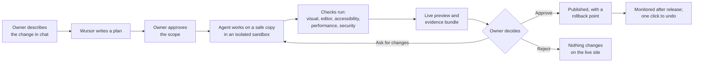
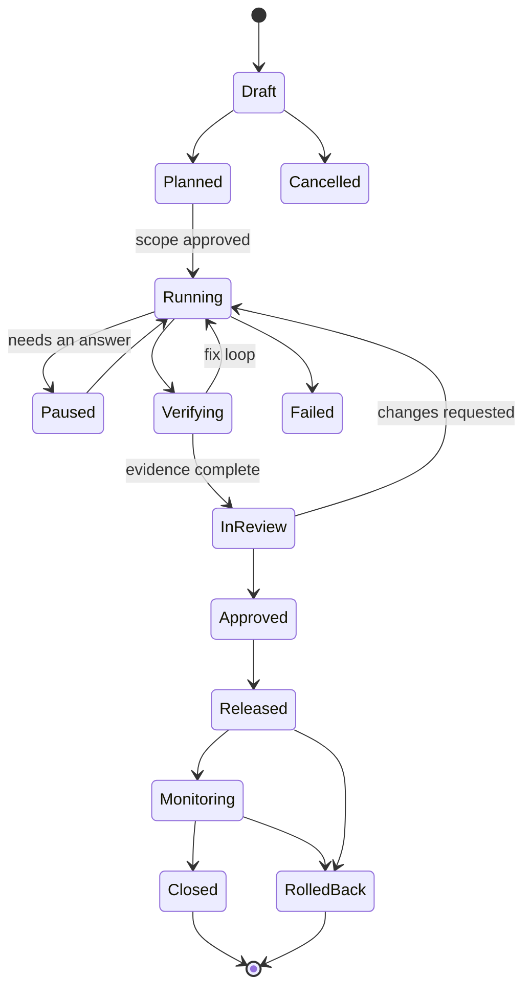
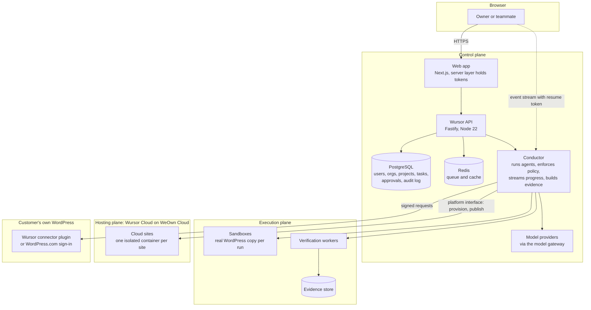
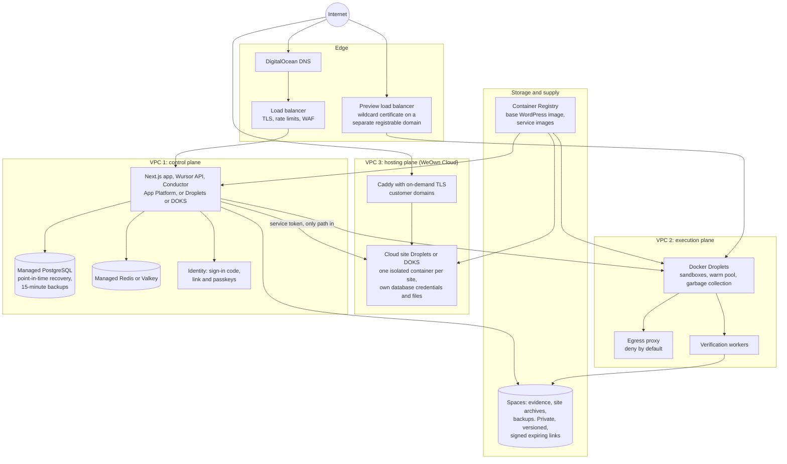

# Wursor

**The agentic WordPress management platform.** Describe what you want. Wursor makes the change on a safe copy of your site, shows you a live preview, and publishes only when you approve.

Wursor is built for people who own a WordPress site but are not technical. They never see a diff, a terminal, a settings maze or an error log. The whole interface is three steps: **chat, preview, approve.**

> **Status in one line:** the web app (marketing site, onboarding, workspace, board, activity, sites, settings) is fully built as a tested front end against stand-in data. The backend, sandbox runtime, hosting and WordPress plugin are early or not started. See [Project status](#project-status) for exactly what is real and what is not.

## Contents

- [What Wursor does](#what-wursor-does)
- [How a change works](#how-a-change-works)
- [Where a site lives](#where-a-site-lives)
- [Core concepts](#core-concepts)
- [Safety model](#safety-model)
- [Architecture](#architecture)
- [Infrastructure](#infrastructure)
- [Repository layout](#repository-layout)
- [Tech stack](#tech-stack)
- [Project status](#project-status)
- [Getting started](#getting-started)
- [Configuration](#configuration)
- [Testing and quality](#testing-and-quality)
- [Security](#security)
- [Documentation map](#documentation-map)
- [Working in this repository](#working-in-this-repository)

## What Wursor does

1. **Connect or start a site.** Connect an existing WordPress site (WordPress.com sign-in or a one-time code with the Wursor plugin), or start a new site hosted by Wursor Cloud.
2. **Say what you want** in plain words: "make my phone number tappable", "add our Sunday hours to the footer".
3. **Wursor works on a safe copy.** An agent plans the change, makes it in an isolated sandbox, and checks its own work.
4. **You review a live preview** and the evidence behind it: before and after, what was checked, what was not.
5. **Approve to publish, or reject and nothing happens.** Every published change keeps a rollback point and can be undone.

There are three kinds of work (PRD section 1.1):

| Lane | Job |
|---|---|
| **A. Editable sites** | Build attractive sites that non-technical owners can safely edit afterwards, from a short brief and a choice of designs. |
| **B. Web apps and PWAs** | Create and update web applications. (Later release.) |
| **C. Existing sites** | Learn a live site first, then propose changes as replayable scripts, tested on a copy before they touch the real site. |

## How a change works



The agent can propose. It can never approve or release. That authority belongs to people (see the [role matrix](./PRD.md) in section 18.2).

## Where a site lives

A site has two separate facts: **where it is built** and **where it lives**. It is always built in Wursor, on a safe copy. After that it lives in one of two places.

| Starting path | For whom | Where the site lives |
|---|---|---|
| **Start on Wursor Cloud** | Someone with no WordPress yet (the default for first-time owners). | Wursor Cloud, running on WeOwn Cloud. Domain, certificate, updates and backups are handled for you. |
| **Connect my WordPress** | Someone with a live site on any host. | Their own WordPress, unchanged. |
| **Build here, publish to my WordPress** | Someone with an empty or new WordPress who wants to keep their hosting. | Their own WordPress. |

A site can **move in either direction** at any time (Cloud to your own WordPress, or the other way), with a verified copy, an approval and a rollback point. Leaving is a supported feature, so Cloud is never a lock-in.

**Access levels.** What Wursor may do on a connected site depends on the access it was given:

| Level | Wursor can change |
|---|---|
| **Full access** | Themes, plugins, settings and content. (Cloud sites always have this.) |
| **Content only** | Pages, posts, media and menus, and nothing deeper. |

## Core concepts

| Object | Meaning |
|---|---|
| **Organization** | The tenant. Owns members, policies and connections. |
| **Project / Site** | A site being worked on, with its home (Cloud or connected) and access level. |
| **Task** | A requested change: description, plan and state. In the product this appears as a card on the **board**. |
| **Run** | One attempt by the agent at a task. A task can have several runs. |
| **Sandbox** | A disposable, isolated copy of the site where the agent works. |
| **Evidence bundle** | Signed results of every check, screenshots and the exact diff. |
| **Approval** | A person's decision, bound to the hashes of the diff and evidence. A new commit voids it. |
| **Release** | Applying an approved change, with a rollback point. |
| **Move** | Transferring a site between homes. It is a release too, with its own plan, evidence and approval. |

A task moves through these states:



On the board, owners see this as lanes: **Idea, Plan ready, Working, Needs you, Ready for you, Done.**

## Safety model

- **The live site is never touched until you approve.** All work happens in a sandbox copy.
- **Approvals bind to hashes** of the exact diff and evidence. Change anything and the approval is void.
- **Everything is undoable.** A safe copy is taken before every publish; the last three deploy snapshots are kept in Wursor's cloud so an undo works even if the site is down.
- **Risk is stated in words** (Everyday, Noticeable, Sensitive, Careful) and decides what always needs a person.
- **Content is data.** Text from a site or page is untrusted and can never raise the agent's permissions (prompt-injection posture).
- **No model keys or site credentials in the browser or on customer sites.** Sites hold only a per-site pairing key.
- **Previews run on a separate domain** with no shared cookies, because generated sites are untrusted code.
- **An append-only, hash-chained audit log** records who did what.

The full threat table and role matrix are in [PRD section 18](./PRD.md). The security review plan is in [docs/security](./docs/security/review-inventory.md).

## Architecture

Wursor owns its **control plane**: its own database, sign-in and API. WordPress sites are target platforms reached only through one **platform interface**. This keeps accounts, approvals and the audit trail independent of any site.



Key decisions (each has an ADR in [docs/decisions](./docs/decisions/)):

| Decision | Why |
|---|---|
| Wursor owns the control plane | Accounts and approvals survive any change to a target platform. |
| Streaming goes straight from the Conductor to the browser | Long-lived connections stay away from request-response services. |
| Sites are reached only through the platform interface | Credentials live in one place; platform-specific code stays out of the product. |
| Cloud sites are a platform target, not a special case | A move between homes is an ordinary release. |
| Sign-in by emailed 8-character code, emailed link and passkeys | Matches the designed screens, with a stronger option for approvers (ADR 0019). |
| Next.js app; Fastify stays as the Wursor API | ADR 0018. |
| Cloud sites run on WeOwn Cloud | ADR 0020. |

## Infrastructure

The target hosting design is [ADR 0022](./docs/decisions/0022-digitalocean-hosting.md): everything runs on **DigitalOcean**, split into **three separate VPCs** that do not share a network trust boundary, defined with **Terraform** in `infrastructure/terraform/`.

> **Not built yet.** `infrastructure/terraform/` and `infrastructure/scripts/` are empty today. This diagram is the design the DevOps work will implement. The service choices are recommendations to confirm in an infrastructure spike.



Network rules that matter (ADR 0022, PRD section 18):

- The **hosting plane has no inbound path to the Wursor API.** Only the Conductor reaches it, with a per-site, revocable service token.
- **Sandboxes have deny-by-default egress** through a proxy, and no standing credentials. They are disposable: idle sandboxes pause after 15 minutes; a 24-hour hard limit destroys them.
- **Previews are served from a different registrable domain** than the app, with no shared cookies.
- **Backups:** database point-in-time recovery with a quarterly restore drill; Cloud sites backed up daily and verified by restore tests, kept 30 days.
- **Media is proxied, never bulk-copied** into a sandbox (ADR 0007).

The handoff brief for the infrastructure engineer, with ordered work items and acceptance criteria, is [infrastructure/DEVOPS.md](./infrastructure/DEVOPS.md). Parts of it predate the Next.js decision, so treat this README and the ADRs as the newer source where they differ.

## Repository layout

```
web/              Next.js (App Router) + TypeScript front end
                    app/            routes, grouped: (marketing) (onboarding) (app) (legacy)
                    src/product     product UI components
                    src/marketing   marketing site
                    src/system      shared feedback: toasts, confirmation, empty and error states
                    src/styles      design tokens and CSS
api/              Fastify + TypeScript API: auth, sessions, chat, sites, pairing, sandbox services
plugin/           WordPress connector plugin (PHP)
infrastructure/   Docker images, compose file, Terraform and scripts (mostly not written yet)
e2e/              Playwright and the agent and golden-file harness
spikes/           Phase 0 written results and the pairing threat model
docs/             Decisions (ADRs 0001 to 0023), security review inventory, front-end build plan
scripts/          Tooling, including the Figma pixel-diff harness
PRD.md            Product requirements (revision 4)
IMPLEMENTATION.md Build guide: TDD rules, sprint plan, CI
CHANGELOG.md      Change log
AGENTS.md         Rules and skills for coding agents working here
```

## Tech stack

| Layer | Choice |
|---|---|
| Web | Next.js 16 (App Router), React 19, TypeScript, plain CSS with design tokens (light and dark), Geist fonts |
| API | Node 22, TypeScript, Fastify |
| Data | PostgreSQL for Wursor data, Redis for streaming and queues |
| Sandboxes | Docker (via dockerode) with a pre-baked WordPress image, overlayfs site layers, a warm pool and garbage collection |
| WordPress side | A standard PHP plugin exposing a token-authenticated REST API |
| Models | Provider adapters (Grok and OpenRouter today), behind a model gateway |
| Tests | Vitest and Testing Library (web, api), PHPUnit (plugin), Playwright (end to end) |
| Packaging | pnpm workspace (pnpm 10.33, Node 22 or later) |
| Hosting (target) | DigitalOcean, Terraform, three VPCs |

## Project status

Be clear-eyed about what is real. Most of the front end is a finished, tested prototype; most of the platform behind it is not built.

| Area | State |
|---|---|
| **Web app** | **Built.** Marketing site (6 pages), sign-up and sign-in, the three starting paths, workspace (chat, preview, approve), Home, Sites, Activity, Board with calendar and list, Settings, command palette, phone navigation, and system states, in light and dark, desktop and phone. Checked against the Figma designs by pixel comparison. **It runs on stand-in data**: nothing is sent to a server yet, and actions such as delete, undo and invite respond locally. |
| **API** | **Early.** Sign-up, sessions, chat (agent loop), site pairing and `/health` exist and are tested. Users are in memory unless `DATABASE_URL` is set. Sign-in by code, link and passkey is not implemented yet. |
| **Sandboxes** | **Logic only.** The Docker client, warm pool, garbage-collection rules and media proxy are written and tested against mocks. No real daemon is wired up. |
| **WordPress plugin** | **Early.** Version 0.1.0 with authentication and REST routes for site info, files, database and WP-CLI. Needs the security review before any real site connects. |
| **Conductor, evidence, approvals, audit log** | **Not built.** Specified in the PRD. |
| **Infrastructure** | **Not built.** A development compose file (WordPress and MySQL) and a placeholder Dockerfile exist. Terraform and deployment scripts are empty. |
| **Wursor Cloud hosting** | **Not built.** Decided (ADR 0020) and designed, with open readiness items around on-call, patching and abuse handling. |

The PRD estimates about 46 weeks to hardening; the rollout milestones are in [PRD section 22](./PRD.md). Nothing in the prototype has been tested with real owners yet, so every usability target is still a hypothesis.

## Getting started

**Requirements:** Node 22 or later and pnpm 10.33 (`corepack enable` will pick up the pinned version).

```bash
pnpm install
```

**Run the web app** (stand-in data, no backend needed):

```bash
pnpm --filter @wursor/web dev        # http://localhost:5173
```

Useful pages: `/` (marketing), `/signup`, `/signin`, `/home`, `/workspace`, `/board`, `/activity`, `/sites`, `/settings`. Many screens accept a query string to show a specific state, for example `/workspace?phase=ready` or `/board?state=empty`. The accepted values are documented in each route's `page.tsx`.

**Run the API:**

```bash
cp .env.example .env                 # then fill in values; never commit .env
pnpm --filter @wursor/api dev        # http://localhost:3000
```

With no `DATABASE_URL` the API uses an in-memory user store, which is fine for development. Sandboxes stay off unless `WUR_ENABLE_SANDBOX=1` and a Docker daemon are available; without them `POST /sessions` returns `503 sandbox_not_configured`.

**Run a local WordPress** for plugin work (development credentials only):

```bash
docker compose -f infrastructure/docker/docker-compose.yml up --build   # http://localhost:8080
```

**Production build of the web app:**

```bash
pnpm --filter @wursor/web build && pnpm --filter @wursor/web start
```

## Configuration

All runtime configuration is environment variables. `.env.example` is the single source of truth.

| Variable | Purpose |
|---|---|
| `PORT` | API port (default 3000) |
| `DATABASE_URL` | PostgreSQL connection. Unset means the in-memory store (development only) |
| `REDIS_URL` | Redis connection (needed for streaming and queues) |
| `SESSION_SECRET` | Session signing. Must be a real secret in production |
| `LLM_PROVIDER`, `LLM_FALLBACK_PROVIDER` | `grok` or `openrouter` |
| `XAI_API_KEY`, `OPENROUTER_API_KEY`, `OPENROUTER_MODEL` | Model provider keys and model |
| `DOCKER_HOST` | Docker daemon for sandboxes (auto-detected locally) |
| `WUR_ENABLE_SANDBOX` | `1` turns on sandbox spin-up |
| `WUR_IMAGE`, `WUR_WEB_PORT` | Base image tag and the host port for sandbox HTTP |
| `PREVIEW_BASE_URL` | Base URL for preview links |
| `WARM_POOL_HOT_SPARES` | Number of ready-to-use sandboxes to keep |
| `WURSOR_API_URL` | Where the web app proxies API requests (default `http://localhost:3000`) |

Secrets come from `.env` (git-ignored) or the environment and are never committed. In deployment they belong in the platform's secret store.

## Testing and quality

```bash
pnpm test                            # every package
pnpm --filter @wursor/web test       # web only
pnpm --filter @wursor/api test
pnpm --filter @wursor/web lint       # type check
pnpm --filter @wursor/e2e test:marketing   # Playwright
```

- **Tests come first.** No implementation without a failing test. Coverage floors: web and api 90 percent, plugin 80 percent.
- **Prove it works.** A task is not done on a claim: run the test, start the sandbox, hit the endpoint.
- The web app was checked against the Figma designs with a pixel-diff harness (`scripts/figma-diff`). Remaining differences from the designs are logged in [docs/design-discrepancies.md](./docs/design-discrepancies.md).
- CI runs install, test and lint on every pull request. Coverage gates and a Docker-based end-to-end job are still to be added.

## Security

- Dependencies are kept current; `pnpm audit` reports no known issues at the time of writing. Indirect dependencies with fixes are pinned with `overrides` in `pnpm-workspace.yaml`.
- A written review plan, covering the API, the plugin, the sandbox, containers and delivery against a 20-point checklist, is in [docs/security/review-inventory.md](./docs/security/review-inventory.md). **The review itself has not been done yet.**
- The sandbox runs untrusted site code. It should get an independent, hands-on test before launch.
- Do not run this code against a live WordPress site or real credentials. Sandboxes are the only environment code runs against.

## Documentation map

| Document | What it covers |
|---|---|
| [PRD.md](./PRD.md) | Product requirements: users, concepts, architecture, security, rollout (revision 4) |
| [IMPLEMENTATION.md](./IMPLEMENTATION.md) | Build guide, TDD rules, sprints, CI |
| [docs/decisions/](./docs/decisions/) | Architecture decision records, 0001 to 0023 |
| [docs/frontend-build-plan.md](./docs/frontend-build-plan.md) | Every screen, its status and how it was verified |
| [docs/design-discrepancies.md](./docs/design-discrepancies.md) | Where the build deliberately differs from the Figma designs |
| [docs/security/](./docs/security/) | Security review inventory and checklist |
| [infrastructure/DEVOPS.md](./infrastructure/DEVOPS.md) | Infrastructure handoff brief and work items |
| [spikes/README.md](./spikes/README.md) | Phase 0 results, including the pairing threat model and the [DigitalOcean hosting spike](./spikes/hosting-digitalocean.md) |
| [CHANGELOG.md](./CHANGELOG.md) | What changed and when |

## Working in this repository

The hard rules (full text in [AGENTS.md](./AGENTS.md)):

1. **Tests first.**
2. **Prove it works.**
3. **Non-technical first.** If a change would put a diff, terminal, settings screen or error log in front of an owner, it is wrong.
4. **Safety.** Never touch a live WordPress site, production credentials or real user data from this repository.
5. **Decisions are logged** as ADRs in `docs/decisions/`.

This repository began as Originmain (an AI design-engineering canvas), then became an engineer-first WordPress desktop tool, and is now Wursor: a web platform for non-technical site owners.
