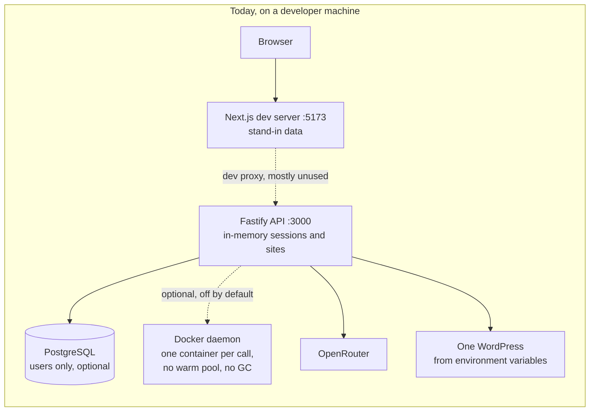

# Wursor: DevOps and Infrastructure Brief

Handoff for the DevOps and infrastructure engineer. It says what exists today, what only exists as a design, what to build and in what order, and how the infrastructure meets the application code.

**Last verified against the code: 2026-10-24** (branch `main` at the merge of PR #2). Where this document and an ADR disagree, the ADR is newer and wins; where the PRD and the code disagree, the code describes today and the PRD describes the target. Product background is in [README.md](../README.md) and [PRD.md](../PRD.md).

---

## 1. The product in one paragraph

Wursor is an agentic WordPress management platform for non-technical site owners. An owner describes a change in chat. An agent makes it on an **isolated copy of the site** (a sandbox), shows a live preview and an evidence bundle, and on approval publishes it to the real site, either one hosted on **Wursor Cloud** (WeOwn Cloud) or the owner's own WordPress through a connector plugin. The sandbox is the safety guarantee: the live site is never touched before an explicit approval, and every publish keeps a rollback point.

---

## 2. Reality check: what exists today

Everything below was read from the repository, not taken from earlier plans.

| Component | Path | State today |
|---|---|---|
| **Web app** | `web/` | **Built, on stand-in data.** Next.js 16 (App Router) front end: marketing site, onboarding, workspace, board, activity, sites and settings. Nothing is wired to the API yet except a development proxy in `next.config.ts` (`/auth`, `/chat`, `/sites`, `/health` forward to `WURSOR_API_URL`, default `http://localhost:3000`). It is a Node server (`next start -p 5173`), **not a static build**. |
| **API** | `api/` | **Early.** Fastify on Node 22. Routes: `GET /health`, `POST /auth/signup`, `POST /sessions`, `POST /chat`, `POST /sites/pair`, `POST /sites/redeem`, `GET /sites/:siteId`, `POST /sites/:siteId/confirm`. 71 unit tests pass. |
| **Sandbox code** | `api/src/sandbox/`, `api/src/services/` | **Written and tested against mocks only.** `DockerClient` contract, `DockerodeClient`, `SandboxManager`, `ImageManager`, `WarmPool`, garbage-collection decision function, DB subset, media proxy, manifest delta. No real Docker daemon has been used by any test or deployment. See 2.1 for what is not wired. |
| **WordPress plugin** | `plugin/` | **Early.** Version 0.1.0: five PHP files (`wursor.php`, `class-auth`, `class-api`, `class-site-info`, `class-admin`) registering REST routes `wursor/v1/site-info`, `/files`, `/db`, `/wp-cli`. Not reviewed for security. |
| **Docker assets** | `infrastructure/docker/` | **Scaffold.** `Dockerfile.wordpress` is a 4-line placeholder (`wordpress:6.7-php8.2` plus WP-CLI). `docker-compose.yml` runs WordPress and MySQL 8 for local development only, with throwaway credentials. |
| **Terraform** | `infrastructure/terraform/` | **Empty** (`.gitkeep`). Designed in ADR 0022. |
| **Deploy scripts** | `infrastructure/scripts/` | **Empty** (`.gitkeep`). |
| **CI** | `.github/workflows/ci.yml` | **Minimal.** On push to `main` and on pull requests: install with a frozen lockfile, `pnpm test`, `pnpm lint`. One Ubuntu job. No coverage gate, no image build, no end-to-end job, no per-package split. |
| **Repository mirror** | `.github/workflows/mirror.yml`, `.gitea/workflows/mirror.yml`, `scripts/mirror.sh` | Mirrors `main` between GitHub and Gitea (`git.weown.tools/pat/wursor`). **Currently failing**; see section 6. |
| **GitHub-managed checks** | (not in the repo) | CodeQL, Dependabot alerts and a Copilot review run from GitHub settings. |
| **Conductor, evidence store, preview router, model gateway, audit log** | n/a | **Not built.** Specified in the PRD only. |
| **Redis** | n/a | **Not used by any code**, although `REDIS_URL` is in `.env.example`. |

### 2.1 What the code does not do yet (so do not assume it)

These were checked in `api/src`. They matter because the older version of this brief described them as done.

- **Warm pool and garbage collection are not running.** `WarmPool` and the `gc` decision function exist and are unit tested, but nothing in the running API calls them. Idle pause and the 24-hour destroy do not happen.
- **Sandbox containers start without ports or labels.** `DockerodeClient.createSandbox` creates a container from the image and a name only. The port mapping (container 80 to `WUR_WEB_PORT`) and the `wursor.managed=true` label live in `ImageManager.containerSpec()`, which `DockerodeClient` does not use. No CPU, memory or network limits are set either.
- **Preview URLs are placeholders.** `POST /sessions` returns `PREVIEW_BASE_URL/<sandboxId>`. There is no router behind that address, and concurrent sandboxes would collide on one host port.
- **`POST /sessions` has no sign-in check.** The other routes that matter use a session guard; this one does not. It also has no limit on how many sandboxes can be started.
- **Only user accounts are persistent.** With `DATABASE_URL` set, users go to PostgreSQL (one migration, `api/migrations/001_init.sql`). **Sessions, sites and pairing codes are in memory** and are lost on every restart. A second API instance would not see them.
- **Sign-in is email and password in the API.** The product design is an emailed 8-character code, an emailed link and passkeys (ADR 0019). None of those exist in the API yet.
- **One WordPress, from environment variables.** `POST /chat` talks to a single site configured by `WP_URL`, `WP_USER` and `WP_APP_PASSWORD`. Per-site credentials and the pairing key are not used by the chat path.
- **Model provider.** Only the OpenRouter client exists. Grok, the provider fallback and `LLM_PROVIDER` are in `.env.example` but not in the code.
- **No migration tooling.** One SQL file; nothing applies it automatically.
- **Two TypeScript errors in `api`** (`src/agents/openrouter-client.ts` import extension, `src/agents/wp-executor.ts` optional value). Tests run through Vitest and pass; `tsc --noEmit` fails. The API has no `build` or `lint` script, so CI does not notice. Decide the build approach (compile, or run with `tsx`) before containerising the API.

### 2.2 What runs, today versus the target

The target runtime, with three separate networks, is drawn in the README and described in section 4.

---

## 3. Environment contract

`.env.example` is the template. The last column says whether the code reads the variable, which the older brief did not.

| Variable | Purpose | Read by code today? |
|---|---|---|
| `PORT` | API listen port (default 3000) | Yes |
| `DATABASE_URL` | PostgreSQL DSN. Set means Postgres user store; unset means in-memory | Yes |
| `WUR_ENABLE_SANDBOX` | `1` enables sandbox spin-up; otherwise `POST /sessions` returns 503 | Yes |
| `WUR_IMAGE` | Base image tag (default `wursor-base:latest`) | Yes |
| `WUR_WEB_PORT` | Host port for sandbox HTTP (default 8080). Only used by `ImageManager`, which the Docker client ignores | Read, no effect |
| `PREVIEW_BASE_URL` | Base for preview links (default `http://localhost:8080`) | Yes |
| `OPENROUTER_API_KEY`, `OPENROUTER_MODEL` | Model access for `/chat` | Yes |
| `WP_URL`, `WP_USER`, `WP_APP_PASSWORD` | The one WordPress `/chat` acts on. **Not in `.env.example`** | Yes |
| `WURSOR_API_URL` | Web app's proxy target (default `http://localhost:3000`) | Yes (web) |
| `DOCKER_HOST` | Docker daemon | Indirectly: `dockerode` reads it itself |
| `REDIS_URL` | Redis | **No** |
| `SESSION_SECRET` | Session signing | **No.** Session tokens are random values held in memory |
| `LLM_PROVIDER`, `LLM_FALLBACK_PROVIDER`, `XAI_API_KEY` | Provider switch, fallback and Grok key | **No** |
| `WARM_POOL_HOT_SPARES` | Hot spare count | **No** |

Secrets come from `.env` (git-ignored) or the process environment. Each deployable should receive only its own secrets; the web app must never receive model keys or site credentials (PRD section 21). In deployment they belong in the platform's secret store.

---

## 4. Target infrastructure (ADR 0022)

Host everything on **DigitalOcean** in **three VPCs** that do not share a trust boundary, defined with Terraform in `infrastructure/terraform/`.

| Plane | Holds | Notes |
|---|---|---|
| **Control** | Next.js app, Wursor API, Conductor (initially one service with two modules), identity, Managed PostgreSQL, Managed Redis or Valkey | App Platform if its streaming and timeout limits fit; otherwise Droplets or DOKS. PostgreSQL needs point-in-time recovery and 15-minute backups with a quarterly restore drill. |
| **Execution** | Docker Droplets running sandboxes, warm pool and garbage collection, verification workers, egress proxy | **Deny-by-default egress** through a proxy; no standing credentials; sandboxes are disposable. |
| **Hosting** (Wursor Cloud, WeOwn Cloud) | One isolated container per customer site, with its own database credentials and file space; certificate issuing for customer domains | **No inbound path to the Wursor API.** Only the Conductor reaches it, with a revocable per-site service token. |

Shared services: **Spaces** (evidence, site archives, backups; private, versioned, signed expiring links), **Container Registry** (base WordPress image and service images), **DigitalOcean DNS**, and a **preview load balancer with a wildcard certificate on a separate registrable domain**, because generated sites are untrusted and must not share cookies with the app.

The diagram is in the README under Infrastructure. The service choices in ADR 0022 are recommendations to confirm in the infrastructure spike, not final.

Readiness items from ADR 0020 that must exist before the first Cloud customer: on-call, patching of critical issues within 72 hours, backups verified by restore tests, abuse handling and a support path. They are people and process, not code.

---

## 5. Work items

Ordered by dependency. Each has an acceptance criterion. Items marked **new** were not in the earlier brief.

### A. Infrastructure as code (new)
Write the Terraform for the three VPCs, firewalls and DNS before anything else, so that every other item lands in code and not by hand. Start with state storage, a staging environment and the control plane.
**Accept:** `terraform validate` and `plan` clean; staging can be created and destroyed from the repository; no secret in state or in the repository.

### B. Containerise and run the API and web app (new)
- Decide how the API is built (see 2.1, the two `tsc` errors) and write images for the API and for the Next.js app (`next build` then `next start`).
- Decide where Next.js runs (ADR 0022 leaves App Platform versus Droplets open) and test long-lived streaming against its limits.
- Pin the Node version (22 or later) and the pnpm version (10.33). pnpm skips build scripts for `esbuild`, `protobufjs`, `ssh2` and `cpu-features` until they are approved with `pnpm approve-builds`; decide per package whether the image needs them.
**Accept:** images build in CI; the stack starts from them in staging; `GET /health` is green.

### C. Docker host for sandboxes
- Provision Docker Droplets in the execution VPC; set `DOCKER_HOST` and `WUR_ENABLE_SANDBOX=1`.
- **Requires application work first** (2.1): the Docker client must apply the container spec (ports, label, limits, network) and sessions must be authenticated.
**Accept:** `docker info` works from the API host; an authenticated `POST /sessions` returns 201 with a sandbox that serves WordPress on its mapped port.

### D. The real base image
`Dockerfile.wordpress` is a placeholder. The target (PRD section 6.2) is WordPress, nginx, PHP 8.x, MySQL 8.x, WP-CLI and Redis, with the WordPress install on a **read-only base layer** and site changes on an **overlayfs layer**. Build and tag `wursor-base:latest`, push to the registry, and build it in CI. Pin base image versions and scan it.
**Accept:** `docker build` succeeds; a container boots and serves WordPress; `wp` works in the container; the image is scanned in CI.

### E. Warm pool, garbage collection, overlayfs
The logic exists (2.1); it is not called. Wire `WarmPool` and the GC decisions to the running service and make the container-level effects real: pause after 15 minutes idle, resume in about 2 seconds, destroy at 24 hours with no exceptions, keep `WARM_POOL_HOT_SPARES` ready.
**Accept:** a sandbox boots in 10 seconds or less from the pool; an idle sandbox pauses and resumes; a 24-hour sandbox is destroyed automatically.

### F. Media proxy
The sandbox's nginx rewrites `/wp-content/uploads/*` to the live origin or a signed Wursor proxy. Media is never bulk-copied; a file is copied only when the agent replaces it (ADR 0007).
**Accept:** a sandbox page renders live-site images without downloading the uploads directory.

### G. Preview routing and TLS
Replace the `PREVIEW_BASE_URL/<sandboxId>` placeholder with dynamic per-sandbox routing on a **separate registrable domain** with a wildcard certificate and no shared cookies with the app.
**Accept:** two concurrent sandboxes resolve to distinct, working HTTPS preview URLs on the preview domain.

### H. Data services
- Managed PostgreSQL with point-in-time recovery. Add a **migration mechanism** (today it is one SQL file applied by hand) and move **sessions, sites and pairing codes** out of memory into the database. Add Redis only when a feature uses it.
- Backups, restore drill, and Spaces versioning for the evidence store.
**Accept:** sign-up and sign-in survive an API restart and work across two API instances; a restore from backup is rehearsed once.

### I. CI/CD
Split the single job into `web`, `api` and `plugin` jobs; add coverage gates (api and web at least 90 percent, plugin at least 80 percent); add the image build; add a Docker-enabled end-to-end job (Playwright and the marketing check); add a build step for the API; keep `--frozen-lockfile`. Pin third-party actions by commit. Add Dependabot version updates and secret scanning in CI.
**Accept:** a green run on a pull request including the end-to-end job, with gates enforced.

### J. Secrets (new detail)
Move every secret into the platform secret store and inject as environment variables per deployable. Remove the Gitea token from the mirror URL (section 6) in favour of a stored credential.
**Accept:** no secret value appears in the repository, images or logs.

### K. Observability
Logs for the API and the sandbox lifecycle; metrics for the warm pool and GC; a trace identifier from the Next.js server through the API, Conductor and plugin. Alerts that page the on-call. Sandbox create, destroy and GC actions are observable.

### L. Security work (new)
- Run the scanners (secret scan over all history, Semgrep, Trivy for images and Terraform, Hadolint, Checkov) and keep them in CI. None are installed yet.
- Support the full review in [docs/security/review-inventory.md](../docs/security/review-inventory.md): the 20-point checklist is not yet run. The review itself has **not** been done.
- Arrange an independent hands-on test of the sandbox boundary before launch. It runs untrusted site code.
- Dependency state on 2026-10-24: `pnpm audit` clean; Next.js 16.4.3, Vitest 4.1.12, Fastify 5.12.7; indirect floors for `undici`, `source-map-js` and `@grpc/grpc-js` pinned in `pnpm-workspace.yaml` `overrides` (remove them when the parent packages catch up).

---

## 6. Repository operations you will inherit

- **Branches and signing.** Commits on `main` are signed with an SSH key. Pull requests run CI; `main` receives merges.
- **History was rewritten on 2026-10-24.** All commit IDs on `main` changed to remove automated-assistant attribution (trailers and author fields). File contents are identical commit for commit. Anyone with an older clone must re-clone or reset; a normal `git pull` will make a mess.
- **The Gitea mirror is failing and needs a decision.** `mirror.yml` merges the Gitea `main` into GitHub's if it is not an ancestor, then pushes to both. The Gitea copy still holds the **pre-rewrite history**, so every run since the rewrite fails with `refusing to merge unrelated histories`. This protects GitHub's `main` (nothing is pushed), but the mirror is stale and the Gitea repository still contains the old commits. Someone with Gitea access must reset Gitea's `main` (and any other branches) to GitHub's rewritten history, then confirm the workflow passes. Do not "fix" it by merging unrelated histories, which would bring the old history back into `main`.
- **Mirror credentials.** The workflow builds the Gitea URL with a token (`secrets.GITEA`) in the URL and gives the job `contents: write`. Review where that secret is stored, who can read workflow logs, and whether a push-only deploy key would do.
- **A stray-file hazard on this machine.** The working copy lives under an iCloud-synced Desktop. It produced conflict copies such as `node_modules/react 2` and files named `index 2` inside `.git`, and very slow file reads. Keep working copies and CI caches outside synced folders.

---

## 7. How DevOps works with the codebase

**Contracts, not re-implementation.** The app reaches infrastructure through three seams:

1. **`DockerClient`** (`createSandbox`, `destroySandbox`, `status`). DevOps makes the daemon side reliable and fills the gaps in 2.1; the interface itself should not be redesigned.
2. **Environment variables**, the only runtime configuration (section 3).
3. **`GET /health` and `POST /sessions`**, the smoke tests: `/health` proves the app is up, `/sessions` proves the Docker path end to end.

**Testing boundaries.** Unit tests mock Docker and Postgres, so CI needs no daemon. Only the end-to-end layer uses real Docker; that job needs a Docker-enabled runner.

**Rules the repository enforces** (see `AGENTS.md`): tests first; prove it works by running it; never touch a live WordPress site or production credentials from this repository; log decisions as ADRs.

**The plugin is not DevOps-owned**, but it lives on customers' sites and shares the deploy path. DevOps provides the cloud side: snapshot storage (the last three deploy snapshots, so an undo works when a site is down) and the media proxy origin.

---

## 8. Risks DevOps must honour (PRD section 13)

- **R1, the agent breaks a sandbox:** copy-on-write checkpoints; sandboxes are disposable.
- **R3, undo when the site is down:** the last three deploy snapshots live in Wursor's cloud.
- **R4, large sites:** task-scoped mirror and media proxy, never a full clone.
- **R8, cost:** no always-on fleet of WordPress plus MySQL boxes. Warm pool is paused images plus one or two hot spares.
- **Hosting commitment:** running Cloud sites makes Wursor answerable for availability, patching, backups and abuse, around the clock. ADR 0020 records the choice and the staffing it needs.

---

## 9. Definition of done for the handoff

- [ ] Terraform for all three VPCs; staging created and destroyed from code (A)
- [ ] API and web images build in CI and run in staging (B)
- [ ] Docker host reachable; authenticated `POST /sessions` returns 201 with a working, port-mapped sandbox (C)
- [ ] Final `wursor-base:latest` built and scanned in CI (D)
- [ ] Warm pool, pause and resume, and 24-hour destroy running; boot 10 seconds or less (E)
- [ ] Media proxy live (F)
- [ ] Per-sandbox preview URLs with TLS on a separate domain (G)
- [ ] PostgreSQL with migrations; sessions, sites and pairing persistent; restore rehearsed (H)
- [ ] CI split by package with coverage gates, image build and Docker end-to-end (I)
- [ ] Secrets in the secret store; none in the repository or logs (J)
- [ ] Logs, metrics, traces and alerts (K)
- [ ] Scanners in CI; security review run; sandbox independently tested (L)
- [ ] Gitea mirror reset to the rewritten history and passing (section 6)

---

## 10. References

- [README.md](../README.md): product overview, architecture and infrastructure diagrams, project status
- [IMPLEMENTATION.md](../IMPLEMENTATION.md): section 1 architecture, section 8 CI/CD pipeline
- [PRD.md](../PRD.md): section 5 architecture, 6.2 sandbox, 13 risks, 18 security, 21 deployment, 22 rollout
- [docs/decisions/](../docs/decisions/): 0007 media proxy, 0013 to 0015 Docker boundary, Postgres and dockerode gating, 0018 Next.js web app, 0019 sign-in methods, 0020 WeOwn Cloud provisioning, 0022 DigitalOcean hosting
- [docs/security/review-inventory.md](../docs/security/review-inventory.md): the security review scope and checklist
- [spikes/hosting-digitalocean.md](../spikes/hosting-digitalocean.md): the hosting spike
- `api/src/sandbox/`, `api/src/services/`: the interfaces DevOps integrates against
